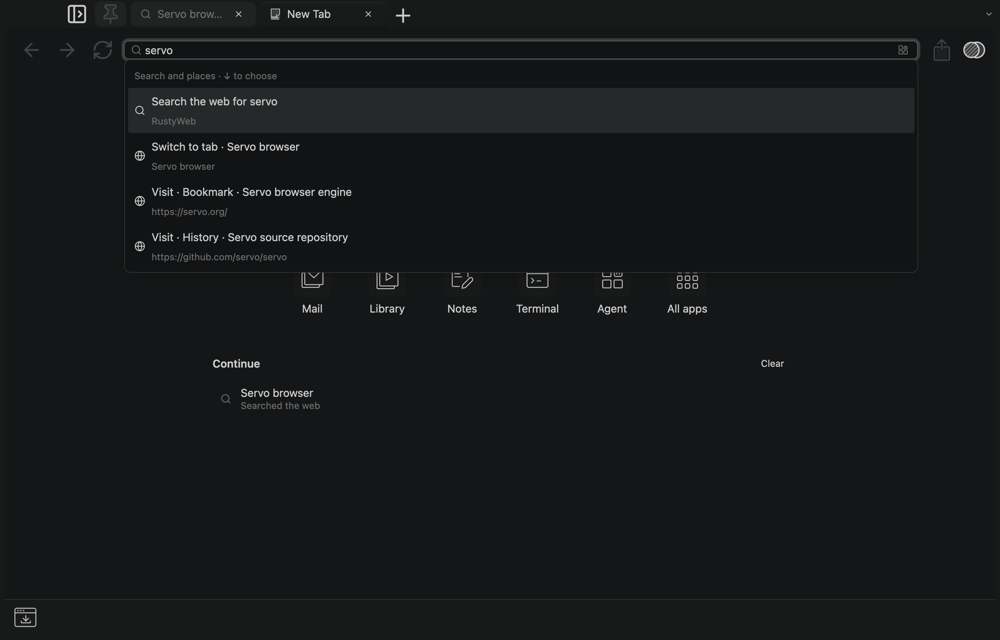

# PR #16 integration acceptance

Integrated PR head `1027a57` with main `b2b3b694fbd487d77e99227b99b0ae075e86be9c`
on macOS arm64, Rust 1.97.1. Source and evidence are in the integration commits on PR #16.
Target directory: `/Volumes/SSD Samsung/cargo-targets/frame-canvas`;
`TMPDIR=/Volumes/SSD Samsung/tmp`. Existing shared dependencies/build state were
reused, with the repository's media environment and tracked dependency patches.

## Review and conflict fixes

- Address input and results share an editing lifetime. Leaving either restores
  the current tab's address. The stable parent focus handle is observed because
  CommandState changes its own focus handle when rendered as non-searchable.
  The first integration run caught this with a failing blur regression; the
  corrected full suite passes.
- New-tab activation, dock selection and panel changes invalidate suggestions
  even when focus remains in the address input.
- History's filter is disabled during clearing. Queued change events also skip
  reads while busy, avoiding contention with legacy cleanup and graph compaction.
- Clearing history now also awaits Home recents and the local search store.
  Queued captures, searches, embedding publication and crawl campaigns are
  invalidated across the clear boundary. Failed disk clears report failure and
  can be retried. The empty-store regression caught and fixed an empty-batch error.
- The SQLite Keychain namespace transfers atomically to RustyRed and survives folder moves, even when the legacy catalog is removed before the first credential read.
  The Platinum app-directory migration and default profile identity remain.
- Current main's session/tree/pins JSON format, import handoff, notes protocols,
  inspector and Servo pin are preserved. The superseded SessionWriter was not
  restored. Profile and legacy/import session records use RustyRed.

## Executed checks

| Command / scenario | Result |
| --- | --- |
| `cargo test --locked -p frame-profile` | 36 passed; three existing opt-in native credential tests ignored |
| `cargo clippy --locked -p frame-profile --all-targets --no-deps -- -D warnings` | Passed |
| `script/media-env cargo test --locked --bin frame` | 197 passed; one existing model-download test ignored |
| `script/media-env cargo build --locked --bin frame --example storage_check` | Passed; existing dependency/application warnings remain |
| `script/media-env python3 tests/storage/check_native.py <target>/debug/examples/storage_check` | Three fresh processes passed; cache requests 1 -> 1 -> 2 |
| `script/media-env cargo build --locked --features performance-check --bin frame` | Passed |
| `FRAME_PERF_ROOT=<temporary root> FRAME_PERF_URL=http://127.0.0.1/?address FRAME_PERF_OUTPUT=<address-native.json> script/media-env <target>/debug/frame` | Exit 0; four expected result kinds; capture visually inspected |
| Scoped `rustfmt --check`, `git diff --check origin/main`, bootstrap Python parse | Passed |
| Cache patch apply/reverse-apply checks against Servo `efdf7370` | Passed |
| Theorem history patch fresh apply/source identity/reverse check; idempotent bootstrap | Passed |
| `python3 script/check-pins.py --require-deps --json` | Passed; checker updated for the bootstrap patch tuple |

The storage harness verifies cookies, localStorage, IndexedDB, bookmarks/index,
legacy/import session records, HTTP disk-cache reuse and separate-profile isolation.
Application tests cover current-main session restoration, tabs/tree/pins, stale
suggestions, frozen selection, Ask separation and the new review regressions.

The preview uses the production Browser and native GPU renderer at 2x scaling.
It types through GPUI's key-dispatch API. Capture explicitly draws the current
model before reading pixels, since an occluded macOS window can retain an older
presented frame. It asserts four rows rather than accepting an empty screenshot.
The synthetic search tab has no live provider configured: its expected unavailable
message is not a live web-search acceptance claim. No personal profile was opened
or migrated, and no application was installed.

Old SQLite files are retained migration inputs, not synchronized rollback copies.
A downgraded binary cannot read subsequent RustyRed writes. History clearing removes
its legacy history copy as well as query/index/revision access, without promising
physical SSD erasure or deletion of external backups.

The namespace follow-up strengthened the existing regression rather than adding
an implementation-mirroring test. `namespace-before.txt` records the failure;
the final profile suite and strict Clippy pass. The application suite and native
restart acceptance were rerun after that migration change. The inspected address
capture predates the metadata-copy and history-clearing follow-ups; its address
UI code is unchanged. The clear operation is exercised through the profile UI
owner in a GPUI test with real durable stores, reopening recents and local search
to verify deletion and bookmark preservation.
