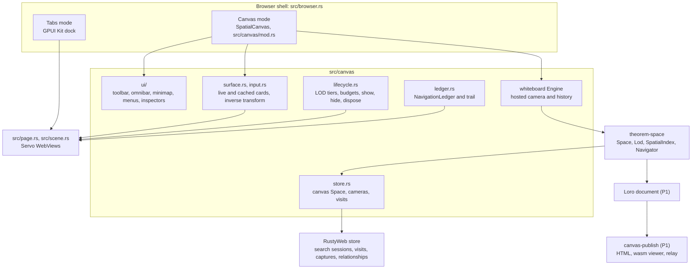

# Spatial canvas: browsing as a place, publishable as a page

Canvas mode lays Frame's pages out on a zoomable board. A page you open from
another stays beside it. Zoom out and the session is a map you can pan; zoom
back in and the same live page, with its session, takes your typing again.
Back takes you to the page you came from by moving the camera to it. The same
board then holds notes, annotations, meaningful relationships and small apps,
and publishes as a web address anyone can open in an ordinary browser, either
view only or open to anyone's edits.

Sources:

- The recording, `~/Downloads/ScreenRecording_10-26-2026 19-04-04_1.mp4`: a
  phone's screen recording of a 26-second video, posted to r/browsers, of a
  spatial-browser prototype running on macOS. It shows how this should feel,
  not a product to copy. Frames are in
  [`recording-grid-a.png`](evidence/spatial-canvas-2026-10-26/recording-grid-a.png),
  [`recording-grid-b.png`](evidence/spatial-canvas-2026-10-26/recording-grid-b.png)
  and the two contact sheets beside them.
- The design notes, verbatim:
  [`design-notes.md`](evidence/spatial-canvas-2026-10-26/design-notes.md).

Builders: Codex for the surface, canvas-core, upstream, server, wasm and Servo
lanes; Sonnet for the GPUI chrome; the orchestrator writes the briefs,
reviews, runs the proofs and commits. The notes plan
([`notes-app.md`](notes-app.md), on `main` since #8; line numbers here are from
its copy on `feat/notes-app`) builds a board for notes. This plan uses that
board and its live web card instead of building a second one.

## Target and acceptance

Three layers, built in order, each usable before the next starts: spatial
(M1 to M4), semantic (S1 to S5) and social (P1, P2). Every item passes with
Theorem disconnected and no model calls; the AI features appear only when AI
is on (decision 21).

**Spatial.**

- **A1, the first demo.** In the notes' words: "open a real website, type
  into it, zoom out so it becomes a small node, pan across the canvas, then
  zoom back in and continue interacting with the same live webpage without
  having lost its session." Checked by script on the local sign-in fixture
  (`tests/canvas/signin/`, a page that sets a session cookie) and by hand on
  a real site you are signed into, with a half-typed textarea: the text, the
  caret, the scroll position and the session survive, and while the board
  zooms the page sees no `resize` event and no change to `innerWidth` or
  `innerHeight`. That last check needs R1's Servo patch.
- **A2, input through the camera.** At zoom 0.35, 1 and 2, input that works
  in Tabs mode works the same on a card and lands where it appears: clicks,
  hover, text selection, wheel scrolling, drags the page handles itself
  through pointer events, IME composition with its candidate window, the
  context menu, `<select>` popups, the colour and file pickers, and alert,
  confirm and prompt dialogs. HTML drag and drop, inside the page and from
  Finder, joins the list when R3 adds it to Servo; this Servo has none, in
  either mode. Servo asks the embedder for no date picker, so a date input
  behaves on a card as it does in a tab. The candidate window, the positions
  of menus, pickers and dialogs, and drops from Finder are checked by hand
  from `tests/canvas/MANUAL.md`; the rest run in `canvas_check`.
- **A3, gestures.** Dragging empty board pans. ⇧-drag on empty board, or a
  drag with the Select tool, draws a marquee. The wheel over a live page
  scrolls the page. Space+drag pans, even over a page, unless an editable
  element in the page has focus. Dragging a card's caption moves the card at
  any zoom; a cached card, which takes no input, moves when dragged anywhere.
  Pinch and ⌘-wheel zoom the board, never the page.
- **A4, one session, two views.** Switching Tabs ⇄ Canvas twenty times
  reloads nothing: the same webview ids, no navigation, and the same
  `scrollX` and `scrollY`, including for a card whose size differs from its
  dock pane (decision 3). Two cards selected with a marquee and opened side by
  side become dock splits of the same two webviews, and the split's way back
  returns them to the board without reloading.
- **A5, Back across pages.** In Canvas mode, after following a link from B to
  C, ⌘[ focuses B and eases the camera to where B was seen, and ⌘] returns
  to C; within one page they are that page's own history. Following a new
  link after Back drops the forward entries, as browsers do, and the trail
  keeps them. Panning, zooming and moving cards add no history. Tabs mode
  Back behaves as it does today.
- **A6, the minimap.** From the notes (lines 140-148 and 511); the recording
  shows none. Bottom-left and fixed to the screen: the cards, the viewport,
  and a fading trail of recent visits and searches. Clicking pans there,
  clicking a trail point focuses its card or search group, double-clicking a
  cluster fits it.
- **A7, restoration.** Quit and relaunch: the arrangement, the camera and the
  trail come back, and every card shows its last thumbnail at once. Only the
  focused card loads at launch; the others load when they become live. A card
  restored from its address returns to its scroll position and says
  "Reloaded" until it is used, so a restored URL is never mistaken for
  retained page state.
- **A8, scale.** A canvas of 60 pages (static pages, single-page apps, video,
  the local sign-in fixture, an accessibility-heavy page) pans with a
  95th-percentile frame time within one refresh interval (16.7 ms at 60 Hz,
  8.3 ms at 120 Hz), measured by `canvas_check` over a scripted ten-second
  pan, with no more pages live than the measured budget. Audio keeps playing
  offscreen. A download, and an upload sent after its page loaded, finish
  while their cards are offscreen. VoiceOver reads the focused page by its
  headings and links, with its cursor drawn where the page is on screen
  (decision 24).
- **A9, search on the board.** A search from the omnibar lays out a search
  group (the query and its results) beside the focused card. Opening a result
  makes that card live where it is, and ⌘[ from it returns to the search
  group.
- **A10, arranging.** Arrange tidies a selection into a grid, as the
  recording's six cards become three by two, or into a pile, in one
  transaction that one ⌘Z undoes.

**Semantic.**

- **B1, notes.** A note card anywhere on the board, edited in place with the
  notes app's editor, its text Loro text (decision 25). "Annotate selection"
  in a page puts a note beside the page with a line to the passage. New notes
  and annotations are private, and the publish preview leaves them out until
  they are included (decision 22).
- **B2, honest anchors.** Annotations use the W3C Web Annotation model. When
  the page changes and the passage no longer matches exactly once, the note
  says it is unresolved. It is never reattached silently.
- **B3, meaningful edges.** Drag from a card, a passage or an app output to
  another, and choose what the link means, or "No meaning" for a plain line.
  The edge records its author, its evidence (a quote and the captured version
  it came from), its visibility and its status. A second person can dispute
  it without removing it. Checked card to card and passage to passage.
- **B4, search this canvas.** Text search over the canvas's pages, notes,
  annotations, edge labels, evidence and app artifacts, plus relationship
  queries such as "what contradicts this". Matches light up, the rest
  recedes, and the camera fits the matches.
- **B5, apps that cite.** A small HTML app on the board declares its sources,
  and the board draws an edge from the app card to each, which opens the same
  inspector as any edge. Clicking one of its chart marks reveals the source
  passage, or the dataset entry behind the mark (a row of a CSV or JSON file
  card), and its lineage exports as PROV-O.
- **B6, other views of the same graph.** The canvas also opens as a table of
  its objects and edges, a document (the canvas read in order, as its
  published page reads), a bibliography of its sources, a graph (cosmos.gl),
  and a structured export for agents (theorem-space's `Export` command). The
  table and the document are editable: renaming, retyping an edge or editing
  a note there changes the board. The bibliography and the graph are
  read-only views of the same records. CSL-JSON, BibTeX and the agent export
  are copies by design, written when asked for.

**Social.** The notes' test, verbatim. Its visitor uses Firefox; the scripted
check also runs with Chrome and Safari as the visitor's browser, since a
published canvas must open in all three (the notes, line 538):

1. A person creates a canvas in native Platinum.
2. They add webpages, annotations, a meaningful relationship, and a small
   interactive application.
3. They publish it as Public · View only.
4. An unrelated person finds it through a normal search engine and opens it
   in Firefox.
5. The initial HTML is readable before the WASM experience finishes loading.
6. The visitor zooms around, searches the canvas, opens an annotation,
   follows a source, and directly links to one node.
7. The owner switches the canvas to Public · Anyone can edit.
8. Two anonymous browser visitors concurrently add a note and connect two
   sources.
9. Both see the changes live.
10. The owner restores an earlier revision.
11. The public URL remains stable throughout.
12. The next indexed checkpoint exposes the updated searchable HTML.

Step 4 waits on a search engine's crawl, which nothing here controls. The
plan makes the canvas indexable (a sitemap, IndexNow, JSON-LD that the Schema
Markup Validator accepts, and `Article` markup that Google's Rich Results
Test recognizes) and records step 4 on the day an engine first returns it.
The other eleven steps run as one scripted check in each browser, and P1 is
done when they and the indexability checks pass.

## Verified baseline — 2026-10-26, rechecked 2026-10-27

Checked in the main checkout (`feat/liquid-glass-chrome` at `2e135c0`); the
notes-app worktree (`/Volumes/SSD Samsung/frame-worktrees/notes-app`,
`feat/notes-app` at `b4695cf`, 61 commits ahead of the main checkout's branch
and missing only `2e135c0`); the Arc worktree (`feat/storage-partitions` at
`2b440b2`, with a WIP snapshot `f7f8e93` on top); the search-scope worktree
(`feat/search-scope` at `37ebc13`); and the main checkout's `deps/` (Servo at
`deps/servo-mse`, `5c8325a3895`; Theorem at `deps/theorem-rustyweb-pw2`,
`6e57dbb39`). The theorem-space and RustyWeb files cited below are unchanged
between `6e57dbb39` and notes-app's `7eb1ba024`. Paths are in the main
checkout unless they name another tree. On 2026-10-27 a review of the plan
was checked against the same trees, and what it found is folded in below.

**Pages in GPUI.**

- Each tab is a Servo `WebView` drawing into its own `SceneRenderingContext`:
  three presented IOSurfaces plus the one Servo draws into, each the page's
  device-pixel size (`src/scene.rs:34-38`, `:234-260`). For a 1440×900-point
  page at 2x that is about 83 MB of colour buffers, before depth buffers and
  Servo's own memory. The newest frame is kept as a `CVPixelBuffer` and shown
  through GPUI's `surface()` with `ObjectFit::Fill` (`src/page.rs:942`).
- `Page::place` resizes the webview to the GPUI rectangle times the scale
  factor whenever either changes (`src/page.rs:752-765`). Today the on-screen
  rectangle is the CSS viewport.
- `Page::device_point` turns window points into device pixels by subtracting
  the page's origin and multiplying by its scale (`src/page.rs:649-655`).
  `controls.rs` goes the other way for menus and pickers
  (`src/controls.rs:134-143`). Neither knows about a camera.
- `Page::set_visible` calls `WebView::show` or `hide` (`src/page.rs:318-326`).
- GPUI's `paint_surface` takes bounds, corner radii and a buffer, and no
  transform (`vendor/gpui-pre/src/window.rs:5155`). A scaled frame is a frame
  painted into scaled bounds, clipped by the content mask.
- `request_create_new` builds a new window's webview at its opener's size and
  queues it with the opener known (`src/delegate.rs:220-243`).
  `request_navigation` decides by URL alone (`src/delegate.rs:202-218`).
- `notify_history_changed` is reduced to a generic `Changed`
  (`src/delegate.rs:176-178`). `Browser::back` steps the active tab's Servo
  history and then falls back to its results page (`src/browser.rs:1177-1191`).
- The delegate does not override `notify_media_session_event`; Servo's
  default is a no-op (`components/servo/webview_delegate.rs:978`).
- Frame's page scripts are pulled, not injected: `src/scripts/read_document.js`
  is run with `evaluate_javascript` after load (`src/page.rs:55`, `:435-445`).
- Right-clicking a page opens Frame's search menu, which carries the page's
  own entries (`src/controls.rs:187-229`).
- The Ask toggle (`ToggleAsk`, `src/browser.rs:1320`) switches the address
  bar between searching and asking; an asked query runs as `SerpMode::Ask`
  (`:1286-1292`, answered through `src/serp.rs:120`).
- Frame has no accessibility for pages: the delegate does not implement
  `notify_accessibility_tree_update`. gpui-pre's vendored copy builds an
  AccessKit tree for GPUI's own elements (`vendor/gpui-pre/src/window.rs:1671-1678`,
  `vendor/gpui-pre/src/element.rs:113-121`).

**Servo** (`deps/servo-mse` at `5c8325a3895`).

- `NavigationRequest` has one public field, `url`
  (`components/servo/webview_delegate.rs:32-37`): no initiator, no
  user-gesture flag, no target. Only a new-window request says which page
  asked.
- `WebView::hide` is the throttle. It hides the webview in the painter
  (`components/servo/webview.rs:497-503`), and the constellation then
  throttles its pipelines (`components/constellation/constellation.rs:5409`);
  a pipeline created later takes the webview's hidden state (`:4887`). Nothing
  else throttles a page.
- `WebView::resize` (`webview.rs:455`), `set_page_zoom` (`:658`) and
  `pinch_zoom` (`:684`) exist. None of them is a canvas camera.
- `resize` fires on any change to a page's viewport details, the scale factor
  included. The resize steps compare the whole `ViewportDetails`
  (`components/script/dom/window/window.rs:3571-3597`), whose equality covers
  the CSS size, the scale factor and the device size
  (`components/shared/embedder/lib.rs:335-346`). The CSS size is itself the
  device size divided by the scale (`components/paint/webview_renderer.rs:1122-1140`).
- No HTML drag and drop: no `DragEvent`
  (`components/script/dom/document/document.rs:6260`, "FIXME(#7529):
  dragevent") and no drag or drop input event
  (`components/shared/embedder/input_events.rs:53-64`). `DataTransfer` and a
  drag data store exist for the clipboard (`components/script/dom/datatransfer`,
  `components/script/drag/drag_data_store.rs`).
- The controls Servo asks Frame to show are a `<select>`, a colour picker, a
  file picker, an input method and a context menu
  (`components/shared/embedder/embedder_controls.rs:35-47`). There is no date
  picker.
- `CreateNewWebViewRequest` carries no URL and no window features
  (`components/servo/webview_delegate.rs:902-905`).
- `load_web_resource` is called as each request starts
  (`components/servo/servo.rs:450`). Nothing reports when a request ends.
- `WebView::set_accessibility_active` returns the page's AccessKit `TreeId`
  (`webview.rs:939`), and `notify_accessibility_tree_update` delivers the
  tree's updates (`webview_delegate.rs:1085`). AccessKit 0.24 grafts a
  subtree under a node by that id (`accesskit` 0.24.1, `src/lib.rs:2181-2187`).
- `SiteDataManager::cookies_for_url` lists a profile's cookies for an address
  (`components/servo/site_data_manager.rs:282`).
- `UserContentManager` (`components/servo/user_content_manager.rs:17`) adds
  and removes user scripts (`add_script` at `:34`, `remove_script` at `:43`).
  Servo queues them when a document's `<head>` is inserted and runs them once
  the DOM is safe to script (`components/script/dom/userscripts.rs:12-33`,
  called from `htmlheadelement.rs:61`). A change reaches a document only when
  it next loads. One manager can serve many webviews; it is set on the builder
  (`webview.rs:1186-1188`). A webview built for a new window starts from a
  fresh builder with none (`webview.rs:1153-1161`), so `request_create_new`
  must pass it, as Servo's own test does
  (`components/servo/tests/user_content_manager.rs:112-121`).

**The board and notes** (notes-app worktree).

- `vendor/gpui-whiteboard` is Theorem's hard fork of zorite's gpui-whiteboard
  0.5.1 (`FORK.md`). Its `Engine` is view-less (`src/engine.rs:316`): `press`
  (`:534`), `drag_to` (`:666`), `release` (`:700`), `wheel` (`:859`) and
  `zoom_step` (`:876`) take input and return what happened. Cards are
  `Role::Card { connectable }` (`:112`), and `Frame.engaged` (`:277`) names
  the element a gesture holds.
- Hosted modes (`src/hosted.rs`): `HistoryMode` (`:35`) and `CameraMode`
  (`:46`) let a host own undo and the camera. A gesture ends in one
  `Commit { before, after, label }` on release (`:78`); camera changes arrive
  as `CameraRequested` (`:91`); `set_constraints` (`:318`) holds pinned
  elements in place.
- `src/space.rs` is the Space adapter. `SpaceBoard` (`:502`) projects a
  `theorem_space::Space` into a scene, `hit` (`:541`) names the Space object
  under a point, and each finished gesture becomes one Space-history command
  (`Route`, `:216`).
- The whiteboard's page card is `EmbedGeom { page_id, title, x, y, w, h }`
  (`src/scene.rs:733-740`): a reference, not a live surface. Painting is
  viewport-culled (`src/lib.rs:87`).
- Nothing in notes-app's `src/` uses the board yet. The live card and the
  board are steps 4 and 9 of the notes plan (`docs/plans/notes-app.md:887-902`,
  `:931-936`). That plan has already decided how a live card zooms
  (`:547-561`): "the host resizes the webview to the card's on-screen pixels
  and sets its scale factor to the board's zoom times the display's, so the
  page stays sharp and never reflows." It does so "While the board zooms",
  where this plan waits for the camera to settle, and it keeps a retired
  card's URL and scroll position. M1 amends it so both plans describe one
  card (decision 1).
- Notes are Loro-backed documents under Theorem's document authority, edited
  with a fork of zorite-editor (`notes-app.md:351-353`, `:437`). The notes
  plan's step 4 brings a minimal editor on that seam and step 6 the full one
  (`:887-916`).
- WebGL2 is on only for `frame-notes:` pages (`src/engine.rs:139` in
  notes-app), which is where cosmos.gl runs.

**The model** (Theorem, `rustyredcore_THG/crates/theorem-space/src`).

- `Placement` (`space.rs:222`) with its `PlacementTarget` (`:67`), `Group`
  (`:272`), `Connection` (`:297`), `PlacementState { Valid, ObjectDeleted,
  Redacted, Unavailable }` (`:161-169`), `Actor { User, Agent, System }`
  (`:36-41`) and `PresentationMode` (`:148`). `Actor::User` carries no id, so
  two people cannot be told apart by it. `PlacementTarget::Note { text:
  String }` (`:74`) is a presentation-only text card.
- `ConnectionClass { Presentation, Semantic { kind }, Executable { shape,
  state } }` (`relation.rs:361-365`). Semantic edges belong to a
  `RelationshipAuthority` (`relation.rs:49`), not to the Space.
- `SpaceOp` (`op.rs:20`), `Transaction` (`:540`), `History` (`:711`), and
  `rebase(remote, local_counters, pending)` (`store.rs:179`), which replays
  pending transactions over a newer remote.
- `Lod { Speck, Overview, Summary, Interactive }`, with `Lod::for_card` and
  default thresholds of 18, 90 and 220 on-screen pixels of a card's smaller
  side (`index.rs:19-52`); `SpatialIndex` over rstar (`:117`).
- `LocalView` (`nav.rs:17`), `arrival_camera` (`:37`) and `Navigator`
  (`:64`): the camera is device-local and never in the shared Space.
- `Capability { Read, Navigate, Arrange, Relate, Bind }`
  (`command.rs:149-155`) and the `SpacePolicy` trait (`:174`). Any command
  not named in `SpaceCommand::capability` needs Arrange (`command.rs:169`).
- `ObjectRef { kind, id }` (`id.rs:81`); JSON Canvas import and export
  (`jsoncanvas.rs`).
- theorem-doc-session declares `loro = "=1.13.9"` and refuses an update whose
  dependencies it does not have
  (`crates/theorem-doc-session/src/restricted_import.rs:31-32`).

**RustyWeb** (Theorem, `apps/browser-substrate/src/programmable_search.rs`).

- A search session already lays out as a theorem-space `Space`:
  `search_canvas` (`:546`), `move_search_card` (`:586`) and
  `retain_search_session` (`:853`). Results are `WEB_RESOURCE` placements
  (`:1201`), captures are `BROWSER_CAPTURE` (`:1228`), and an ephemeral
  session is never written (`:551`, `:634`). A session is named by a string
  `session_id` (`:347`).

**Unmerged branches this plan builds on.**

- Arc (`feat/storage-partitions`): `crates/profile` has `SurfaceId(u64)` with
  an allocator, and `SessionTab` (`crates/profile/src/lib.rs:40-77`), and its
  `Tab` is keyed by `id: SurfaceId` (`src/browser.rs:110-112`) where the main
  checkout's has `id: u64` (`src/browser.rs:89-90`). Its sidebar
  `Placement { Today, Pinned }` (`crates/profile/src/placement.rs:10-13`) is
  not theorem-space's `Placement`. A profile is `Profile { id: i64 }`, with no
  id type of its own (`crates/profile/src/lib.rs:18-22`), and a sidebar Space
  is `SpaceId(i64)` (`crates/profile/src/space.rs:9`), a different type from
  theorem-space's string `SpaceId` (`id.rs:38`).
- Search scope (`feat/search-scope`): `Scope { Web, Library, Mail, History,
  Apps }` (`src/scope.rs:38-44`) and `Browser::open_beside`
  (`src/browser.rs:722-741`), bound to ⌥Enter (`src/main.rs:105`). It records
  the split through the `u64` tab id that the Arc branch replaces with
  `SurfaceId`, so the two meet when both merge.

**Pins.**

- Servo, pinned in `script/bootstrap-media`: the main checkout pins
  `5c8325a3895` (rounded selection, one commit on `81d8e299956`); notes-app
  pins `2b522612c4d` (27 commits on the same base: the WebGL2 work and trusted
  initiators for embedder schemes), checked out at
  `/Volumes/SSD Samsung/frame-webgl2-lane/servo` and linked from notes-app's
  own `deps/`. The storage-partitions Servo work (S1 of the Arc plan) is
  uncommitted in `/Volumes/SSD Samsung/frame-deps/servo-partitions`.
- Theorem, pinned in `script/bootstrap`: the main checkout pins `7ef4dfe0c`,
  but its `deps/theorem-rustyweb-pw2` is checked out two commits later, at
  `6e57dbb39`; notes-app pins `7eb1ba024`, seven commits after that, through
  `/Volumes/SSD Samsung/theorem-worktrees/notes-frame-pin`. Each contains the
  one before it.
- `2e135c0` moves `script/bootstrap-media` to `5c8325a3895` and adds a
  selection check that needs it, so it cannot merge into notes-app without
  losing one side's Servo work. M1 starts from `feat/notes-app` as it is, and
  the two revisions converge in P0.

## What the code says about the notes

The notes are right about the architecture. These are the places where the
code says otherwise, or says more. Line numbers are in the saved notes.

1. **"Servo also exposes resource-throttling behavior in its webview API."**
   (line 163). Not as its own call: hiding a webview is what throttles it
   (`constellation.rs:5409`). The lifecycle has three operations: show, hide
   and dispose.
2. **"In the current Page::place() implementation, the GPUI rectangle
   determines the Servo viewport size."** (line 87). Right (`page.rs:752`). But pure
   compositor zoom, which the notes propose instead, blurs a page whenever you
   zoom in and keeps full-size buffers for every small card. The plan uses the
   compositor during gestures and the notes plan's resize with a matching
   scale factor once the camera settles, not while it moves (decision 3).
3. **"its page-card element is an embedded page reference"** (line 62).
   Right (`EmbedGeom`). The board does not grow a live-surface element: Frame
   paints live surfaces itself, on the board's one camera (decision 1).
4. **"Two separately managed cameras would eventually disagree about
   positions, zoom levels, selection bounds and pointer interactions."**
   (line 67). Already avoided upstream: the fork's `CameraMode::Hosted` gives the host the only
   camera.
5. **"Reuse the existing RustyWeb search result model to create search-root
   and result nodes."** (line 282). Further along than the notes say: RustyWeb already
   writes a search as a Space of `WEB_RESOURCE` placements. M3 extends that
   store instead of starting a layout.
6. **The data model and the level-of-detail policy.** The notes describe both
   as new work. theorem-space already has placements, groups, the three
   connection classes, capabilities, a navigator with device-local cameras,
   LOD tiers with calibration and a spatial index. It is the canvas model
   (decision 2).
7. **The seven identities** (lines 218-248). Three exist as types: SurfaceId
   in the Arc branch, and SpaceId and PlacementId in theorem-space. A profile
   is `Profile { id: i64 }` in the Arc branch, with no ProfileId type, and a
   search session is RustyWeb's string `session_id`. The Arc branch also has
   a `SpaceId(i64)` of its own, which is not theorem-space's; decision 5 says
   which is which. VisitId and TrailEntryId are new (decisions 6 and 7).
8. **Navigation connections, which the notes call "mechanically observable
   without AI"** (line 156). They are. For a new window Servo names the
   opener, and for an in-place navigation the page it came from is the same
   webview's previous history entry, which `notify_history_changed` reports.
   What `NavigationRequest` lacks is a flag saying whether the person started
   it. Links open beside in Canvas mode for the design reason in open
   decision 2 (decision 8), not because in-place navigations can't be traced.
9. **"a Cosmograph research panel"** (line 301). Cosmograph is licensed CC BY-NC 4.0,
   which rules out commercial use. The notes plan uses cosmos.gl, its
   MIT-licensed engine (`notes-app.md:922`). A research panel on the board is
   a cosmos.gl page on `frame-notes:`, the one scheme with WebGL2.
10. **`https://platinum.rs/c/...`** (lines 552-686). That domain is registered and served by an
    Apache server (it answered 403 Forbidden on 2026-10-26). Unless it is
    yours, publishing needs a domain you control (decision 20).

## Decisions

1. **One board, one camera.** `SpatialCanvas` (`src/canvas/mod.rs`) hosts the
   whiteboard's `Engine` in hosted camera and history modes. It feeds the
   engine pointer input, owns the camera, and paints three layers: the
   board's own elements through the whiteboard's painter (notes, groups, ink,
   edges, captions); page cards through Frame's surface painting, each
   clipped to its card; then overlays (annotation highlights, selection, the
   minimap). It is the notes plan's step 9 board, and its live card is that
   plan's step 4 card: written once, on the notes-app line, used by both
   plans. M1 amends `notes-app.md` (`:547-561`) to match decisions 3 and 9,
   so the two plans describe one card.

2. **theorem-space is the canvas model.** A canvas is a `Space`, cards are
   `Placement`s, clusters are `Group`s, visual edges are `Connection`s, and
   meaningful edges belong to a relationship authority (decision 13). Frame
   imports it as `use theorem_space as canvas` where names would collide.

3. **Hybrid zoom.**
   - A card's world size is its page's CSS viewport. A new card takes its
     opener's size; a page first placed from Tabs mode takes its dock pane's
     size; otherwise 1280×800.
   - In Tabs mode a page fills its dock pane, as today. A page whose card
     size differs from its pane is resized on each mode switch, as a window
     resize would, and keeps its scroll offset (A4).
   - During a gesture or an eased camera move nothing resizes: each card
     paints its newest frame into its scaled bounds.
   - When the camera settles, each live card at `Interactive` LOD gets its
     world size as its CSS viewport and zoom times the display's scale as its
     scale factor, in one call (R1). Device pixels match the screen, the CSS
     viewport stays the world size, and the page re-rasterizes sharp without
     reflowing.
   - The device-pixel size is capped, starting at the window's own pixel
     size; past the cap the compositor scales up.
   - Dragging a card's edge changes its world size. That is the one way to
     reflow a page; it reflows live, like a window resize, and commits on
     release.
   - This Servo fires `resize` on every scale change and derives the CSS size
     by dividing the device size by the scale, so a rounded device size can
     move `innerWidth` by a pixel (baseline). Today's `place` also sets the
     scale and the size as two messages (`page.rs:757-762`). R1 fixes all
     three in the Servo lane.
   - Gate (M1 builds it): a probe page logs `resize`, `innerWidth`,
     `innerHeight` and `devicePixelRatio` while the camera runs 1 → 0.35 → 2
     → 1. Zero `resize` events and constant inner sizes pass. On this Servo
     the gate fails, and M1 keeps its record for R1. `devicePixelRatio` may
     change, as it does when a window moves between displays.

4. **What a card points at.**
   - A page card's target is `ObjectRef { kind: "browser_surface", id:
     <SurfaceId> }`. Navigating inside the page never edits the Space; the
     caption shows the surface's current favicon, title and host.
   - An unopened search result is RustyWeb's `web_resource` placement.
     Opening it turns that placement into a page card and keeps its id,
     position and edges, which needs `SpaceOp::SetTarget` upstream (U1).
   - A SurfaceId survives dispose and restore. A restored surface starts a
     new Servo history from its URL, scrolls back to where it was when it was
     disposed, and its card says "Reloaded" until it is used.
   - A surface has at most one card per canvas. Two cards of one address are
     two surfaces, or one surface and one `web_resource` card.

5. **One canvas per Arc Space.** Tabs and Canvas are two views of one Space's
   surfaces: Tabs is the GPUI Kit dock, as today, and Canvas is the board.
   Each canvas is a theorem-space `Space` in the profile's own store, whose
   string `SpaceId` is derived from the Arc branch's `SpaceId(i64)` as
   `arc-space-<n>`. In this plan `SpaceId` means theorem-space's, and the Arc
   type is written `profile::SpaceId`. The Arc lane renames its sidebar
   `Placement { Today, Pinned }` to `Section` before M2, so `Placement` means
   one thing in Frame. A public canvas someone else owns belongs to no Space
   (decision 18).

6. **Persistence extends the RustyWeb store.**
   - The canvas Space, its device-local cameras and its trail live in the
     RedCore store that already holds search sessions, through new `canvas_*`
     functions beside `search_canvas` (U1).
   - Writes happen on the engine's `Commit`, at the end of a gesture, never
     per pointer move. In the notes' words: "Never put a database commit on
     every pointer-move event." The camera is written when idle; trail
     entries are batched.
   - A visit gets a `VisitId` and `opened_from`: the visit, or the search
     session (RustyWeb's `session_id`), it came from. Navigation edges and
     the trail read them.
   - Upstream changes go on a Theorem branch. Frame's pin moves only after
     Frame builds against that branch
     ([learning](../learnings/2026-10-26-build-frame-before-moving-theorem-pin.md)),
     and `deps/` is never edited in place.

7. **The NavigationLedger** (`src/canvas/ledger.rs`).
   - An entry is `{ TrailEntryId, target, camera }`, where the target is a
     surface with its history index, or a search group. A navigation inside
     a page (reported by `notify_history_changed`), activating another page
     (a link opened beside, a card or trail point clicked) and opening a
     search group each append one. Back and Forward move the cursor without
     appending.
   - Appending after Back drops the forward entries from Back and Forward,
     as browsers do. The trail keeps every entry, so the minimap still shows
     them.
   - Back to the same surface steps Servo's history. Back to another surface
     or to a search group focuses it, eases the camera to the entry's camera
     (gpui-pre's easing; a jump under Reduce Motion) and returns keyboard
     focus to the page.
   - When a page moves its own history (`history.back()`, a single-page
     app's router), `notify_history_changed` reports the new index and the
     ledger follows it.
   - Panning, zooming and moving cards never append.
   - Tabs mode keeps `Browser::back` (`browser.rs:1177`).
   - Each canvas keeps its trail (decision 6), and the minimap draws it.

8. **In Canvas mode, links open beside.**
   - A user script, `src/scripts/canvas-links.js`, runs in the top-level
     document and listens for `click` on `window` in the bubble phase. It
     finds the link in `event.composedPath()`, so a link inside a shadow root
     is found rather than its host. For a trusted, unmodified, primary-button
     click on an `<a href>` or `<area href>` to another document, with no
     `target` or a `target` of `_self` or `_top`, that the page has not
     already handled (`defaultPrevented` is false, so single-page-app routers
     keep working), it calls `preventDefault` and
     `window.open(href, "_blank", "noopener")`. It leaves alone `download`
     links, links that target a named frame, `javascript:` and other non-web
     schemes, and links within the same document.
   - A listener the page adds to `window` itself can run after Frame's; M2
     checks a Turbo site, which listens there. A page that stops a click's
     propagation keeps it from Frame's listener, and that link navigates in
     place, as ⌥-click does; the ledger records it as a step within the page
     (risk 6).
   - Each window's webviews share one `UserContentManager`, which Frame
     passes explicitly in `request_create_new`, whose builder starts without
     one. The script carries the window's mode and is inert in Tabs mode. A
     mode switch replaces the script, for documents that load later, and sets
     the mode in live pages with `evaluate_javascript`.
   - The click reaches `request_create_new` with its opener known. Frame
     places the new card beside the opener (to the right, then below, never
     over another card), records the visit's `opened_from`, draws the
     navigation edge, focuses the card and eases the camera to it.
   - ⌥-click navigates in place. `target="_blank"` and `window.open` already
     open beside.
   - A new window that keeps `window.opener` is a popup: a scripted
     `window.open` without `noopener`, which is how sign-in popups talk back
     to their opener. `CreateNewWebViewRequest` carries neither the URL nor
     the window features, so Frame reads `window.opener !== null` in the new
     page once it loads. A popup is a transient card beside its opener that
     leaves no trail entry and goes away on `window.close()`
     (`notify_closed`); if the person navigates on from it, it becomes an
     ordinary card. A window opened by canvas-links.js or by
     `target="_blank"` has no opener and is an ordinary card.
   - M2 checks that Servo keeps `noopener` on this path. If it does not, the
     script opens without it and sets the new window's `opener` to `null`.
   - Tabs mode is unchanged.

9. **Lifecycle follows level of detail** (`src/canvas/lifecycle.rs`).
   - A card's tier comes from `Lod::for_card` and from whether `SpatialIndex`
     finds it on screen:
     - focused: live (shown, placed on settle, takes input);
     - `Interactive` and on screen: live while the live budget allows,
       largest on screen first; otherwise cached;
     - `Summary` or smaller, or off screen: hidden, and painted from its
       newest frame;
     - hidden beyond the memory budget: disposed, least recently focused
       first, after recording its scroll position, and restored from its URL
       to that position when next needed;
     - an unopened search result: a native card with title, snippet and
       preview, and no webview.
   - Never disposed: the focused card, a card playing media
     (`notify_media_session_event`), a card with a request in flight (R2;
     `load_web_resource` reports only a request's start), which covers
     uploads sent after the page loaded, a card typed into since its last
     load, and a card set to "Keep live". Downloads already run apart from
     their page (`src/downloads.rs`).
   - A hidden card paints its context's newest frame, which stays valid while
     Frame neither paints nor presents that webview, as M1 confirmed. A
     downscaled thumbnail is written to memory and to the profile's
     directory, keyed by SurfaceId, whenever a card is hidden and for every
     card at quit (`src/canvas/thumbnails.rs`), so a relaunch, and the blur
     behind a focused card, can paint cards before their pages load.
   - The live budget is 6 cards, the focused card among them. M1 measured
     GPUI at the display rate through 6 animating cards in one run and 7 in
     the other; past that the window slows, and from 12 it stops
     responding. Any live card can start animating, so the budget counts
     live cards, not cards seen animating.
   - Live cards are painted within a time budget per frame. Today the
     delegate paints and presents in `notify_new_frame_ready`
     (`src/delegate.rs`), once for every Servo frame, and M1's process
     sample at 11 cards found 95% of the main thread there. Instead:
     - `notify_new_frame_ready` only marks its page as waiting and asks the
       window for a frame, as servoshell's `set_needs_repaint` does
       (`ports/servoshell/running_app_state.rs:881`);
     - a `Window::on_next_frame` callback, which GPUI runs at the start of a
       frame, before it draws (`vendor/gpui-pre/src/window.rs:1866-1874`),
       paints and presents waiting pages: the focused card first, then the
       longest waiting, until the frame's budget is spent;
     - the rest wait for the next frame, so none starves, and frames that
       arrive while a page waits cost nothing, since one paint shows its
       newest state.

     The budget starts at half the refresh interval. M1's sample puts one
     paint and present at roughly 1 ms (95% of the main thread over about
     850 card frames a second), so about four fit in a frame at 120 Hz.
     Painting each card at most once per frame would not be enough on its
     own, since a card makes about 90 frames a second, already under the
     display rate. This adds no latency, because GPUI showed a presented
     frame only at its next draw anyway, and Tabs mode takes the same path.
   - The memory budget is a ceiling on the process's physical footprint, the
     number M1 took from `vmmap`; Frame reads it in-process through `libc`'s
     `proc_pid_rusage` (`ri_phys_footprint`). A live or hidden card costs its
     whole webview: 92.7 MB on M1's fixture, of which about 33 MB is GPU
     memory that RSS misses and 2.8 MB is IOSurface, and hiding frees none
     of it. So the lifecycle reads the footprint, on each pass and once a
     second since hidden pages keep loading, instead of adding up surfaces:
     - while the footprint is over the ceiling, it disposes hidden cards,
       least recently focused first, and reads the footprint again after
       each, because a disposed card still left about 10 MB in M1;
     - a macOS memory-pressure warning (a `dispatch2` memory-pressure
       source) halves the ceiling until pressure returns to normal, and a
       critical one disposes every hidden card that is not exempt;
     - it stops when no hidden card is left to dispose; exempt cards stay.

     The ceiling starts at a quarter of physical memory, about 90 webviews
     like M1's on a 32 GB Mac. Unlike the live budget, that figure is a
     choice rather than a measurement, and M4 checks it on the 60-page
     canvas.
   - Smoothness comes from compositing and these caches, never from asking
     many pages to render at new sizes.

10. **Navigation edges are observed, not authored.** They are drawn from
    visits' `opened_from`, styled as the trail and hidden with it, and they
    are not Space connections. "Keep this link" turns one into an authored
    edge (decision 13), explicitly.

11. **Clusters are Groups.** A search, or a run of links opened from one
    page, makes a theorem-space `Group` around its cards. Double-clicking a
    cluster in the minimap fits its group. Each card has a caption under it:
    the favicon, the title, and the site's host in grey. Group labels show
    at `Overview` and below. Arranging a selection as a grid or a pile is one
    transaction, so one undo (A10).

12. **Annotations** (S1).
    - The W3C Web Annotation data model. A target is the page's URL with a
      TextQuoteSelector (exact, prefix, suffix) and a TextPositionSelector,
      plus the captured version when there is one.
    - Anchoring runs in the page, in a user script (`src/scripts/anchor.js`)
      that bundles `@apache-annotator/dom` 0.2.0. It matches exactly; zero
      matches or several is "unresolved", and the note keeps its quote and
      says so.
    - "Find similar" is offered only on an unresolved note.
      `dom-anchor-text-quote` 4.0.2's approximate match proposes a passage,
      and the person accepts or rejects it.
    - Both libraries are vendored as prebuilt bundles under
      `src/scripts/vendor/`, each with its version, its licence and the
      command that built it, so the cargo build has no Node step.
    - Frame paints the highlights; the page's DOM is never changed. The
      script returns each anchored range's client rects, and Frame maps them
      through the card's transform. Highlights hide while the page scrolls
      and come back from fresh rects once it stops, because rects pulled
      after each frame would trail the page by a round trip.
    - An annotation's note is a note of decision 25, with a visibility like a
      relationship's (decision 22). U2 indexes each annotation, its quote and
      its note as it is saved, for S3.
    - Evidence names a captured version. "Capture a version" stores a
      `BROWSER_CAPTURE`, and annotations and edges made from it cite that
      capture's revision.

13. **Meaningful edges** (S2).
    - A relationship joins a subject and an object, each a card, a passage
      (an annotation's target) or an app output, with a predicate (supports,
      contradicts, cites, derived from, related to, or a custom label), its
      author, when it was made, its evidence (a quote and a captured
      revision) and its visibility (private, shared or public; decision 22).
    - Each person's stance is its own assertion record: asserts, disputes or
      retracts. The status the board shows (authored, disputed, retracted) is
      computed from those records and never stored. An authored relationship
      is its author's claim, not a fact.
    - An assertion names its author by a person id: an owner key's public key
      (decision 18), or a visitor's id on a public canvas (U5). theorem-space's
      `Actor::User` carries no id, so the records do not use it.
    - Frame implements `RelationshipAuthority` over the RustyWeb graph store
      (U3), and the board draws relationships as
      `ConnectionClass::Semantic { kind }`. U3 indexes relationships, their
      labels and their evidence as they are saved.
    - The menu that names a new edge lists "No meaning" first, which draws a
      plain `ConnectionClass::Presentation` line (the notes, line 352).
    - The edge inspector shows type, author, evidence, visibility and each
      person's stance, and opens the relationship in the other views (the
      notes, line 509): its two ends side by side, its row in the table, its
      place in the document, and its neighbourhood in the graph.

14. **Search this canvas** (S3).
    - `Scope::Canvas(SpaceId)`, with theorem-space's id (decision 5), joins
      search-scope's `Scope` once that branch merges.
    - Text: the existing Tantivy index, filtered to the canvas's objects: its
      pages (through their visits and captures), notes, annotations, edge
      labels and evidence, and app manifests and outputs, which U2, U3 and U4
      index as they are written.
    - Relationships: a traversal over semantic edges ("contradicts",
      "supported by").
    - Meaning: RustyWeb's embeddings, only when AI is on (the two `ort`
      learnings of 2026-10-25 apply).
    - With AI on, a "contradicts" query also proposes passages the meaning
      lane finds that may disagree (the notes, line 427). They show as
      candidates the person accepts as relationships or dismisses, and none
      is stored until accepted.
    - Results light the matching cards and edges, dim the rest and fit the
      camera to the matches. Escape restores the board.
    - "Find related material" on a page is a more-like-this query over the
      local index and the canvas plus a web search on the page's title, so it
      works with AI off; with AI on, embeddings join the ranking.

15. **Apps** (S4).
    - An app is an HTML bundle with an `app.json`: a stable app id, a name,
      an entry, sources (object references), outputs, a state class and
      permissions. Its revision is the bundle's content hash, so a new bundle
      with the same id keeps the app's state, sources and edges.
    - In Frame, an app on a canvas you own is a Servo surface on a
      `frame-app:` protocol (`src/apps.rs`). It calls Frame through `_api`
      fetches on that protocol, gated by the initiator check the notes plan
      added for `frame-notes:` (Servo `2b522612c4d`). An app on a canvas you
      don't own (decision 18) runs as it does on the web, with no `_api`.
    - On the web it is a sandboxed iframe on a separate origin that talks by
      `postMessage`. One client library, `platinum-app.js`, hides the
      difference from the app.
    - State is read-only, local (per viewer), shared (a map in the canvas's
      Loro document) or external. S4 builds read-only, local and external
      state; shared state comes with P1's Loro document.
    - External state goes through an explicit authority flow (the notes,
      lines 665-674). The app declares the service in `app.json`, and each
      viewer who wants it signs in to that service with their own account
      from inside the app. The token stays with that viewer (the Keychain in
      Frame, the app origin's storage on the web) and never enters the
      canvas, and the publisher's accounts are never used for anyone else.
      Edit access to a canvas never grants it. Without a sign-in the app
      shows its static fallback.
    - The board draws each declared source as an edge from the app card,
      which opens the same inspector as any edge (the notes, line 442).
      Outputs record `prov:wasDerivedFrom` for their sources, and
      `reveal(source)` asks the host to fly to the source and highlight it:
      a passage, or a dataset entry, which is a row of a CSV or JSON file
      card.
    - U4 indexes each app's manifest and outputs as they are written.

16. **Sync** (P1).
    - One edit path everywhere: the UI makes `SpaceOp`s in a `Transaction`
      and applies them locally, and for a shared canvas the Loro bridge
      carries them.
    - Clients run Loro natively and in wasm. Frame's crates declare
      `loro = "1.13.9"`, a caret requirement, as the
      [learning](../learnings/2026-10-26-library-crates-take-caret-requirements.md)
      says. theorem-doc-session's `=1.13.9` is what holds the native app, the
      wasm viewer (one workspace, one lockfile) and the server (Theorem's
      lockfile) to one version, and P1 checks `cargo tree -i loro` in all
      three builds.
    - Note and annotation text are Loro text (decision 25), so two people
      typing in one note merge (the notes, line 641).
    - The server checks each visitor update with theorem-doc-session's
      validate-before-merge import (`restricted_import.rs`): import into a
      staging copy, diff, lower the diff to SpaceOps, check those against the
      policy (decision 17), then merge or reject. Every later update from
      that visitor depends on a rejected one, and the server refuses those
      too (`restricted_import.rs:31-32`). So after a rejection the visitor's
      client drops its unsent changes, reloads from the server under a new
      Loro peer id, and says which change was refused.
    - A visitor's delete makes a tombstone the owner can restore (the notes,
      line 606); only the owner deletes for good.
    - Z-order is a `LoroMovableList`. Presence (cursors, selections) is
      Loro's `EphemeralStore` and is never saved.
    - The working canvas and the published one are separate. "Publish update"
      first imports the public head into the working canvas, so visitors'
      accepted edits reach the owner's canvas under their visitor ids. It
      then rebases the working canvas's unpublished transactions onto the
      public head with theorem-space's `rebase`, after the publication filter
      and the preview's choices (decision 22) have removed what stays
      private, such as private notes and local app state. The preview lists
      any that no longer apply.
    - Loro owns the live merge, RustyRed owns identity and meaning, and each
      durable checkpoint (decision 18) lowers the Loro state into a RustyRed
      revision.

17. **The two access settings are capability bundles.**
    - **Public · View only:** Read and Navigate, plus layout changes and
      filters kept only in the visitor's browser (the notes, line 659).
    - **Public · Anyone can edit:** adds Arrange, Relate and Annotate: moving
      and adding cards, adding pages as link cards, connecting, notes and
      annotations (the notes, line 576). Never Bind, never an app's external
      state, never a hard delete.
    - Upstream (U5): a `Visitor { id }` actor with anonymous ephemeral ids, a
      public `SpacePolicy`, a tombstoned placement state, and an `Annotate`
      capability. U5 also gives every command an explicit capability in place
      of the `_ => Capability::Arrange` default (`command.rs:169`), and a
      test lists each operation's capability: moving, resizing, grouping,
      z-order and tombstoning need Arrange, edges need Relate, notes and
      annotations need Annotate, and a hard delete belongs to the owner
      alone.
    - Every operation records its actor, its prior and next revision, and its
      time. The owner can restore any revision, pause edits, or switch back to
      view only. In the notes' words: "Permissionless contribution, not
      permissionless destruction."
    - These ship with the preset, not after it: per-actor rate limits, size
      limits per operation and per canvas, a malicious-link check on the
      server, rollback, a report link on every public canvas, and an operator
      takedown that hides a canvas.
    - The link check uses hash-prefix lookups. Google's Safe Browsing API is
      for non-commercial use only; a service that earns revenue must use Web
      Risk instead (https://developers.google.com/safe-browsing). The
      orchestrator asks the user which applies before deploying (decision 18).

18. **Hosting.**
    - A publish service, `apps/canvas-publish` (axum), in the Theorem repo,
      behind theoremweb's nginx or on its own host.
    - The server-rendered page carries the title, description, authorship,
      notes, annotations, source links, edge labels, app descriptions and a
      linear reading of the canvas, so it reads without the wasm and without
      Platinum. It embeds Schema.org `CreativeWork` and `Article` and Web
      Annotation JSON-LD, with each app output's `prov:wasDerivedFrom` (the
      notes, line 444), a canonical link and Open Graph tags, and puts
      `rel="ugc nofollow"` on links visitors add.
    - The service also serves the routes (decision 20), the wasm bundle, the
      Loro WebSocket relay, a sitemap, IndexNow pings, and
      `/c/<slug>/search?q=`: JSON for the viewer and a results page for the
      server-rendered page's search form, answered from a Tantivy index of
      the live head. Share-with-link pages (P2) are `noindex`.
    - There are three heads: the live head, durable checkpoints and the
      indexed publication revision (the notes, lines 619-625). A durable
      checkpoint is cut after a quiet period of ten minutes with no accepted
      edit, hourly while edits arrive, and when the owner publishes or
      restores. Each durable checkpoint becomes the indexed revision. The
      page is rendered from it and the wasm then syncs to the live head, so a
      transient drag or passing vandalism never reaches the index (the
      notes, line 615).
    - Owners are known by Ed25519 keys: the device's theorem-mesh identity
      where there is one, otherwise a key in the macOS Keychain, kept as a
      synchronizable item so iCloud Keychain carries it to the person's other
      Macs. A canvas accepts several owner keys, any of which adds or revokes
      the others, and the first publish offers a recovery key to export and
      keep. With every key lost, the canvas stays up and the report link and
      takedown still work, but no one can change it as its owner.
    - Opening a public canvas's address in Frame opens it in a new window as
      a visiting canvas. It belongs to no Space and is kept only as a cache,
      its pages are link cards as on the web, a source you follow opens in
      the profile that window came from, its apps run sandboxed with no
      `_api` (decision 15), and its edits go to the server as a visitor's.
      Forking it (P2) makes it a canvas of your own.
    - Deploying the service, and registering or pointing a domain, are
      outward-facing. The orchestrator asks the user before each.

19. **The web viewer.**
    - Spike W0 comes first: the vendored whiteboard on gpui-pre-web 0.3.9 in
      Firefox, Safari and Chrome over WebGL2, including the typing, IME
      composition and focus that visitors' notes need. The fallback is
      theoremweb's stack (Zed's gpui 0.2.2 with gpui_web).
    - Servo types stay inside `src/canvas/surface.rs` and
      `src/canvas/lifecycle.rs`, so the board and model can move into
      `crates/canvas` (shared) and `crates/canvas-web` (wasm) for P1 (W1)
      without untangling them.
    - Whether GPUI Kit runs in wasm is unknown. The web viewer uses gpui
      directly, so P1 does not depend on it.
    - The server's HTML stays in the page after the viewer loads, as the
      page's accessibility tree: the board's `<canvas>` is `aria-hidden`, and
      moving focus through the HTML's objects moves the camera to them (the
      notes, line 540).
    - The viewer's chrome follows the native canvas's brief: the search
      field, zoom and fit, the layers control, the edge inspector, the access
      setting and the report link. The design gate judges it on screenshots
      from all three browsers, against the Design Guides' principles rather
      than their GPUI Kit components, which the viewer doesn't use.
    - Search calls the service's `/c/<slug>/search` (decision 18).

20. **Domain and routes.** The service takes its base URL from configuration.
    Routes, as the notes give them (lines 552-634): `/c/<slug>`,
    `/c/<slug>/node/<slug>`, `/c/<slug>/annotation/<slug>`,
    `/c/<slug>/edge/<slug>` and `/c/<slug>/revision/<hash>`. Slugs are stable;
    renaming one adds a redirect. P1 cannot ship until the user names a domain they control.
    Custom domains per canvas come later.

21. **AI is optional.** Every acceptance item passes with Theorem disconnected
    and no model calls, and spatial browsing never needs Theorem. AI is on
    while Theorem is connected, which Ask already needs to answer
    (`SerpMode::Ask`, `src/browser.rs:1286-1292`). While it is on, Canvas
    mode adds:
    - Ask in the omnibar, with the selected cards, or else the focused one,
      as its context: their addresses, titles and `read_document.js` text
      (the notes, line 301). Built in M3.
    - The meaning lane of search, and the candidate disagreements a
      "contradicts" query proposes (decision 14).
    - Embeddings in Find related's ranking.

    While it is off, the Ask toggle and the meaning lane are hidden, and Find
    related ranks without embeddings.

22. **What publishing includes.**
    - Pages publish as link cards: title, description, favicon, address, and
      the person's annotations and edges, because many sites refuse to be
      framed. A visitor follows a source by opening it in a new tab. A
      capture of a page is published only when the person opts in for that
      page (privacy and copyright).
    - Notes, annotations and relationships each have a visibility: private,
      shared (with the people a canvas is shared with, P2) or public. New
      ones are private, since a working canvas holds half-written
      annotations and unpublished notes (the notes, lines 519 and 697).
    - Never published: private notes, annotations and relationships, local
      app state, the trail, visits, search sessions and other profiles' data.
    - The publish preview shows exactly what will become public, and any
      object can be left out of it (the notes, lines 474 and 521). It flags
      each page viewed while the profile held cookies for its site
      (`SiteDataManager::cookies_for_url`), since its title, address or
      quotes may show signed-in content, and each annotation or edge that
      quotes such a page; flagged objects stay out until the person includes
      them. Private notes, annotations and relationships are listed apart,
      each with a switch to include it, and one switch includes them all.

23. **Pins.** Before M2, converge the committed Servo lines, notes-app's
    `2b522612c4d` and the Arc branch's `6bb5b4fb7eb`
    (`Travis-Gilbert/navigation-action`, which holds the main checkout's
    `5c8325a3895` and the committed storage-partitions work), and move every
    Theorem pin to `7eb1ba024`'s line, so every lane builds against the same
    engine and model. Each worktree's `deps/` then links the same two
    checkouts. R1 to R3 join the converged revision the same way as each
    lands.

24. **Accessibility** (M4).
    - Frame turns Servo's accessibility on for each live page with
      `WebView::set_accessibility_active`, which returns the page's AccessKit
      `TreeId`, and implements `notify_accessibility_tree_update` to pass the
      page's updates on (`src/canvas/a11y.rs`).
    - Each page's tree is grafted under its element's node in the tree
      gpui-pre already builds for its own elements, through AccessKit 0.24's
      graft nodes. Bounds go through the card's transform, so VoiceOver's
      cursor is drawn where the page is, and they update when the camera
      settles.
    - Tabs mode gets the same bridge at the identity transform. A cached card
      exposes only its caption, and the board's own elements report their
      roles through gpui's `a11y_role`.

25. **Notes** (M4).
    - A note card is a note in the notes app's sense: a Loro-backed document
      under its document authority (`notes-app.md:351-353`), placed as
      `ObjectRef { kind: "note" }` and edited in place with the notes app's
      editor, the zorite-editor fork (`:437`).
    - A note made on the board belongs to the canvas, under the same
      authority. A vault note dragged in from the notes app is placed by
      reference and stays in the vault.
    - theorem-space's `PlacementTarget::Note { text }` is used only for JSON
      Canvas text nodes imported without an owner, and editing one turns it
      into a canvas note.
    - An annotation's note is the same kind of document. On a public canvas,
      a visitor's note lives in the canvas's Loro document (P1).
    - M4 uses whichever editor the notes plan has by then: step 4's minimal
      editor on the authority seam, then step 6's.

26. **Liquid Glass chrome** (the user, 2026-10-27). Canvas mode keeps
    Frame's Liquid Glass chrome, which is the intended design; the final
    version ships with it.
    - The board is the window's clear glass, as the frame around the cards is
      in Tabs mode. It replaces the recording's painted gradient.
    - Cards stay opaque, as pages do.
    - The floating chrome (toolbar, omnibar, action strips, zoom, layers) and
      the site panel sit on the theme's field colour over the glass, so text
      never sits on the glass alone.
    - The finished glass is on `feat/native-home`: clear glass tinted by its
      own tint (`836f791`), glass through a page's toolbar and selected tab
      (`c14173e`), and a page's chrome in its own colour with light mode kept
      light (`013f42d`), with `glass::pane`, `glass::field` and
      `glass::seen`. `feat/notes-app` has only the first glass commit
      (`74e432f`), and so do `feat/liquid-glass-chrome` and
      `feat/storage-partitions`. P0 brings the finished glass into the canvas
      branch.
    - The chrome kit reads its surface colours from `src/canvas/ui/mod.rs`,
      never from a colour of its own, so the merge only points those
      functions at `glass::pane` and `glass::field`.
    - `render_to_image` captures only GPUI's layer. Design-gate screenshots
      of glass come from the window itself (`screencapture`), over more than
      one background.

## Architecture



Both modes draw the same `Page` entities; switching modes changes who paints
them, never the pages themselves.

| Path | Lane | Contents |
|---|---|---|
| `src/canvas/mod.rs` | canvas-core | `SpatialCanvas`: the engine host, the camera, paint order |
| `src/canvas/surface.rs` | surface | live and cached card painting, the settle resize, the inverse transform |
| `src/canvas/input.rs` | surface | gesture ownership |
| `src/canvas/lifecycle.rs` | surface | tiers, budgets, dispose and restore |
| `src/canvas/thumbnails.rs` | surface | thumbnails, written when a card is hidden and at quit |
| `src/canvas/a11y.rs` | surface | grafting pages' accessibility trees through the camera (decision 24) |
| `src/canvas/ledger.rs` | canvas-core | the NavigationLedger and the trail |
| `src/canvas/branch.rs` | canvas-core | placing pages beside their opener; groups |
| `src/canvas/store.rs` | canvas-core | the canvas Space, cameras, trail and visits through RustyWeb |
| `src/canvas/annotate.rs` | surface | anchoring and highlight geometry (S1) |
| `src/canvas/views.rs` | canvas-core | table, document, bibliography and export views (S5) |
| `src/canvas/ui/` | chrome | toolbar, omnibar, action strips, minimap, layers and zoom controls, card chrome, site panel, menus, inspectors, publish sheet |
| `src/apps.rs` | surface | the `frame-app:` protocol host and its `_api` (S4) |
| `src/scripts/canvas-links.js`, `src/scripts/anchor.js`, `src/scripts/site-panel.js` | surface | user and page scripts |
| `src/scripts/platinum-app.js` | surface | the app client library, also served by canvas-publish (S4, P1) |
| `src/page.rs`, `src/controls.rs`, `src/delegate.rs` | surface | camera-aware coordinates; painting within the frame budget; history, media, close and accessibility events |
| `src/browser.rs` | canvas-core | the Tabs/Canvas switch; Canvas-mode Back |
| `examples/canvas_check.rs`, `tests/canvas/` | surface | headless checks, built like `media_check`; the sign-in fixture and `MANUAL.md` |
| Servo fork (`Travis-Gilbert/servo`) | servo | the viewport call (R1), request activity (R2), drag and drop (R3) |
| Theorem `rustyredcore_THG/crates/theorem-space` | upstream | `SetTarget` (U1); `Visitor`, the public policy, tombstones, `Annotate` and explicit capabilities (U5) |
| Theorem `apps/browser-substrate` | upstream | canvas store and visits (U1), annotations (U2), relationships (U3), apps (U4), each indexed as written |
| Theorem `apps/canvas-publish` | server | the publish service (U6) |
| `crates/canvas`, `crates/canvas-web` | wasm | the split for the web viewer (W1) |

## The canvas, as the recording shows it

This is the chrome lane's brief. The input rules at the end belong to the
surface lane.

**What the recording shows** (frames in the evidence folder):

- Cards float on a soft gradient with no window chrome, each with a caption
  under it: the favicon, the title, and the site's host in grey ("Vitsœ
  www.vitsoe.com").
- Focusing a card brings it to reading size, and the rest of the board
  recedes behind it, blurred and washed out. Painting the neighbours from
  their smallest thumbnails, scaled up, gives that blur without a blur pass.
- Zooming in goes on past reading size until the page fills the window edge
  to edge (grid-a frame 3; sheet-01, top row, frames 5 to 8).
- Beside a focused card, a site panel shows the page's favicon, title and
  description, its colours as swatches, and its fonts as "Ag" specimens with
  each font's name and role ("Headings", "Body").
- With nothing focused or selected, a field at the bottom centre reads
  "Find, ask, or enter URL", with two icons to its right: a diamond and a
  four-corner fit icon.
- A strip of four small icons takes the field's place at the bottom centre
  of the window, wherever the card or selection is (in grid-a frame 7 the
  selection is left of centre and the strip stays centred). There are two:
  - for a focused card, read as open or expand, a pen, a speech bubble or
    magnifier, and a bin (grid-a frames 1 and 9);
  - for a selection, read as split columns, arrange (with a tooltip), the
    same third icon, and a bin (grid-a frames 7 and 8).
- Zoomed out, pages sit in clusters. A marquee selects several (blue
  outlines). Arranged, a pile of six becomes a three-by-two grid (grid-a
  frames 7 and 8); opened, they animate into a side-by-side split of the same
  live pages, which then scroll normally. A small button sits at the foot of
  the split's divider.
- A thin handle sits on the window's left edge (grid-a frames 1 and 4).
- No minimap appears in any frame; A6's comes from the notes (lines 140-148).

**What to build.**

- **Frame's chrome in Canvas mode.** It is the Liquid Glass chrome
  (decision 26): the board is the window's clear glass in place of the
  recording's gradient, cards stay opaque, and the floating chrome sits on
  the field colour over the glass. The traffic lights stay. The sidebar
  collapses to the handle on the left edge and slides out over the board on
  hover. The address row gives way to the omnibar, and the board takes the
  rest of the window.
- **Toolbar**, a pill at the top centre: Select, Pan, Link, Note, Insert,
  Find. Insert offers a page by address, a note, an app, and a file or image:
  an image becomes an image card drawn natively, a CSV or JSON file a file
  card with a table view (B5's dataset entries), and any other file a file
  card with its name, kind and size that opens in its default app. Find
  focuses the omnibar.
- **Omnibar**, bottom centre, "Find, ask, or enter URL". An address opens a
  card beside the focused one. Text offers "On this canvas" (S3) and "Search
  the web" (a search group, A9). Right of it, the diamond is the Ask toggle,
  shown only when AI is on (decision 21), and the four corners are Fit all.
- **Action strips**, in the omnibar's place while a card is focused or a
  selection exists:
  - a focused card: Expand (zoom until the page fills the window, again to
    come back), Annotate, Ask with AI on or Find related without it, Remove;
  - a selection: Open side by side, Arrange (a grid, or a pile), Ask or Find
    related, Remove.
- **Minimap**, bottom left: cards, viewport, fading trail (A6), painted from
  the same Space and ledger. There is no second scene.
- **Layers and zoom**, bottom right: a layers control that shows or hides
  the trail with its navigation edges, the semantic edges and the
  annotations, so the trail reads on its own with the semantic graph hidden
  (the notes, line 158); and a zoom control (out, the percentage, in).
- **Card chrome**: the caption below the card, which is also what you drag to
  move it.
- **Site panel**: the favicon, title and description, the theme colour, a
  palette quantized from the card's frame (`kmeans_colors`), and the fonts
  with their names and roles, from `document.fonts` and computed styles.
  `src/scripts/site-panel.js` reads them with the same evaluate-and-pull
  pattern as `read_document.js`.
- **Context menus**, by target. On a page, Canvas mode extends Frame's
  existing menu, which leads with search; the page's own entries stay.
  - empty board: Paste (an address becomes a page card, text a note, an
    image an image card, files file cards, at the pointer), New note, Insert
    page, Select all, Fit all;
  - a page card: Annotate page, Connect to another node, Find related
    material, Capture a version, Copy reference (the page's title and
    address as a Markdown link, plus the node's public link once the canvas
    is published), Open in Tabs, Keep live, Remove from canvas;
  - text selected in a page: Annotate selection, Copy, Search this canvas,
    Search the web;
  - an edge: Change meaning, Show evidence, Dispute, Remove;
  - an app card: Show sources, Permissions, Reset state.
- **Linking**: with the Link tool, or by dragging from a card's connector,
  drop on another card, passage or app output, then choose the meaning from
  a short menu that lists "No meaning" first. The edge inspector shows type,
  author, evidence, visibility and stances, and opens the relationship's
  other views (decision 13).
- **Share and Publish** in the upper right (the notes, line 511); inspectors
  on the right, collapsible.
- **Publish sheet**: Web address, Access (the two settings), Preview public
  version (decision 22), Publish.
- **Open side by side**: a selection animates into dock splits of the same
  live webviews. The button at the foot of the split's divider brings them
  back to the board, to where they were. Nothing reloads.
- **Focus mode**: double-clicking a card's caption, or Return with a card
  selected, eases it to reading size, recedes the board and opens the site
  panel beside it. Expand, or ⌘Return, zooms on until the page fills the
  window. Escape steps back out one level at a time, once the page has had
  it.
- **Mode switch**: Tabs ⇄ Canvas in the toolbar and on a shortcut. The
  focused page animates between its dock rectangle and its card.

**Input rules.**

- Escape goes to the page first. If the page does not consume it, focus
  returns to the board.
- Space pans only when no editable element in the page has focus. A Space
  press without a drag goes to the page.
- Clicking a live card focuses it and delivers the click. Clicking a cached
  card only makes it live; the click is not delivered, since its picture may
  be stale.
- Popovers Frame draws for a page (menus, pickers) close when the camera
  moves. A modal dialog focuses its card and brings it into view.
- The board zooms by pinch, ⌘-wheel and the zoom control. Keyboard zoom
  shortcuts keep zooming the page.
- Under Reduce Motion, camera moves jump instead of easing.

**Design gate.** Each chrome slice is judged on a rendered screenshot against
the GPUI Kit Design Guides by someone other than its builder, as in the Arc
plan's design review gate. The web viewer's chrome goes through the same gate
on screenshots from all three browsers (decision 19).

## Implementation sequence

Each step names its lanes, files, upstream needs and what done means. Codex
and Sonnet leave their changes uncommitted; the orchestrator reviews, runs the
proof and commits.

**P0. One engine for every lane.** (Servo lane and orchestrator.) Converge the
Servo and Theorem pins (decision 23): the two committed Servo revisions first,
then R1 to R3 as each lands. Before changing `theorem_rev` in
`script/bootstrap` or the Servo revision in `script/bootstrap-media`, the
orchestrator builds and tests Frame, and `frame-notes` where the branch has
it, against the candidate through a detached worktree linked at that
worktree's `deps/` path
([learning](../learnings/2026-10-26-build-frame-before-moving-theorem-pin.md)).
That check matters here: `7eb1ba024` added required methods to Theorem's
`DocumentAuthority` trait and fields to `AuthorityCommit`. Only the
orchestrator relinks `deps/`. P0 also merges `feat/native-home`'s finished
Liquid Glass (decision 26) into the canvas branch, and points the chrome
kit's surface colours at it. Done when Frame's tests pass on the converged
pins in the notes-app branch and in the Arc branch, and the canvas branch
draws the finished glass. M2 needs it; M1 starts on notes-app's pins.

**R1. A viewport that holds still.** (Servo lane, in a checkout of the fork
of its own.) One `WebView` call that sets a page's CSS viewport size and
scale factor together. Servo takes the CSS size as given instead of dividing
the device size by the scale, sizes the device surface as the CSS size times
the scale, rounded up, and fires `resize` only when the CSS size changes,
which is when the CSSOM View spec fires it. A Servo test covers a scale-only
change. Frame's `Page::place` and the settle resize switch to the call. Done
when that test passes and M1's zoom gate, against the patched Servo, records
zero `resize` events and constant inner sizes.

**R2. Requests in flight.** (Servo lane.) Servo tells the embedder when each
of a webview's requests starts and when it ends; `load_web_resource` reports
only the start. Frame keeps a count per page, and the lifecycle never
disposes a card with a request in flight (decision 9). Done when a test
page's upload, sent after the page loaded, keeps its card from being
disposed until the upload finishes, and the card is disposed once it has.

**R3. HTML drag and drop.** (Servo lane.) `DragEvent` and the HTML
drag-and-drop processing model, built on the `DataTransfer` and drag data
store Servo already has for the clipboard, and drag input events in the
embedder API, so Frame can pass on drops from Finder (GPUI's external
drops). Frame maps them through the camera like any pointer event. Done when
A2's drag-and-drop items pass in Tabs mode and on cards at all three zooms.
Whether to offer the work to Servo upstream (its issue 7529) is the user's
call, since it is outward-facing.

**W0. Web viewer spike.** (wasm lane, in its own worktree, alongside M1.)
Build the vendored whiteboard's scene for `wasm32-unknown-unknown` on
gpui-pre-web 0.3.9 and open it in Firefox, Safari and Chrome. Done when, in
all three, a 200-element board pans, zooms, selects and drags; a text element
on it takes typing, including IME composition with its candidate window
(Japanese input); and focus moves from the board into the text and back, by
click and by Tab and Escape. Otherwise done when the report says what failed
and the same check has been run on theoremweb's stack. The report goes in the
evidence folder and settles open decision 3.

Result, 2026-10-27, from `spike/web-viewer`:
- Both stacks pass in Firefox and Arc, except Tab from the board into text and
  back.
- Real Chromium input maps correctly.
- The bundled font has no Japanese, so the spike loads Noto Sans JP, which
  adds 5.9 MB gzipped.
- The user ruled Safari out of the acceptance, and open decision 3 is settled.

**M1. One live page on a zoomable board.** (Surface and canvas-core lanes, on
a branch from `feat/notes-app` as it is. `2e135c0`'s rounded selection waits
for P0, since it pins another Servo revision. This is also the notes plan's
step 4 live card.)

1. `SpatialCanvas` hosting the `Engine` with a hosted camera and history,
   with one card bound to an existing `Page`.
2. The card paints the page's newest frame into its scaled bounds, rounded,
   and clipped to the card and the board.
3. Camera-aware `device_point` and `window_point`: they take the card's
   screen rectangle and zoom, and every input path and every embedder control
   uses them (A2).
4. Gesture ownership (A3), in `src/canvas/input.rs`.
5. The settle resize and its gate (decision 3). On this Servo the gate
   records the `resize` events that scale changes fire, and how far
   `innerWidth` and `innerHeight` drift; that record goes in the evidence
   folder, and R1 is measured against it.
6. Measurements: how many live cards hold the display's frame rate; memory
   per live, hidden and disposed card; the cost of making a hidden card live
   and of restoring a disposed one; whether a hidden card's newest frame
   stays valid.
7. The local sign-in fixture (`tests/canvas/signin/`), the zoom probe, and
   the list of manual checks (`tests/canvas/MANUAL.md`).
8. `docs/plans/notes-app.md` amended (`:547-561`) to describe this live
   card: resized when the camera settles rather than while the board zooms,
   and restored to its scroll position.

Done when A1 to A3 pass by hand and in `examples/canvas_check.rs`, apart from
A1's zero-`resize` check, which waits for R1; the gate's record and the
measurements are in the evidence folder; and the two plans agree.

**M2. Many pages, one history, two views.** (Canvas-core and surface lanes,
after P0 and the Arc merge.)

- `src/canvas/ledger.rs`, `src/canvas/branch.rs`, a first
  `src/canvas/store.rs`, the Tabs/Canvas switch in `src/browser.rs`,
  `src/scripts/canvas-links.js` with the popup rule (decision 8), and
  `notify_history_changed`, `notify_media_session_event` and `notify_closed`
  in `src/delegate.rs`.
- Selection by marquee, and Open side by side with its way back, sized by
  decision 3's rule.
- U1, on a Theorem branch: `SpaceOp::SetTarget`, the `canvas_*` store
  functions, and `VisitId` with `opened_from`.
- Painting within the frame budget, and the live budget (decision 9), in
  `src/delegate.rs` and `src/page.rs`, for both modes. M2 is the first step
  with many live pages, so both land here. The memory budget needs dispose
  (M3) and lands in M4.
- Chrome: the mode switch, card captions, both action strips with the
  actions that exist by then (Expand, Open side by side, Remove), and the
  split's way back.

Done when A4 and A5 pass; links open beside with their navigation edges,
including a link inside a shadow root; a named-frame link, a click the page
stops, a Turbo site and a sign-in popup each behave as decision 8 says;
twenty mode switches show the same webview ids and no navigation events;
`media_check` still passes; and `canvas_check`'s measurements, on M1's
workload, show that:
- with the live budget lifted, 16 animated cards keep GPUI at 95% of the
  display rate or more in each of three two-second samples, and every card
  still presents at least 10 times a second;
- with the live budget in place, 6 animated cards present at a median
  within 10% of M1's 85.6 fps.

**M3. Search groups, minimap, restoration.** (Canvas-core, surface and chrome
lanes, after U1 lands.)

- Search groups from RustyWeb's search Space (A9), as trail points; the
  minimap (A6); dispose and restore with thumbnails, scroll positions and the
  "Reloaded" state (A7); and Ask with the selection as its context
  (decision 21).
- Chrome: the omnibar with Ask and Fit all, the minimap, the layers control
  and the zoom control.

Done when A6, A7 and A9 pass, including a relaunch with twenty cards that
come back at their scroll positions, and, with AI on, Ask answers about two
selected pages.

**M4. Scale, notes, plain edges and accessibility.** (Surface, canvas-core
and chrome lanes; R2 for the upload exemption.)

- The memory budget, the thumbnail store and the keep-live exemptions
  (decision 9); note cards (decision 25) and plain visual edges
  (`ConnectionClass::Presentation`); groups and their labels; Arrange (A10);
  and the accessibility bridge (decision 24).
- Keyboard traversal on the board, which W0 found missing in the shared
  whiteboard and which the native canvas and the web viewer both need:
  - Tab and Shift-Tab move to the next and previous text element and focus
    its editor;
  - Tab leaves the editor and moves on;
  - Escape commits and returns focus to the board.
- Chrome: the toolbar, focus mode, the site panel, Arrange in the selection
  strip, and the context menus that need no later step.

Done when A8, A10 and the note half of B1 pass on the 60-page canvas, with
VoiceOver, a playing video, a download and an upload among its pages. On
that canvas the footprint stays under the ceiling, and a simulated
memory-pressure warning and then a critical event
(`memory_pressure -S -l warn`, then `-l critical`) dispose hidden cards as
decision 9 says, while the exempt cards stay.

The notes' fourth milestone also lists annotations and relationships. They
are S1 and S2 here, because the notes' semantic layer redefines both (W3C
annotations with honest anchors, relationships backed by assertions), and
building a simpler version first would mean building them twice.

**S1. Annotations.** (Surface and chrome lanes; U2 upstream: annotation
records in the RustyWeb store, indexed in Tantivy as they are saved.)
`src/scripts/anchor.js`, `src/canvas/annotate.rs` and the annotation UI
(decision 12), with Annotate in the focus strip. Done when B1 and B2 pass,
including a page that changed between visits, whose note shows it is
unresolved, and highlights that hide while the page scrolls.

**S2. Meaningful edges.** (Canvas-core and chrome lanes; U3 upstream:
relationship and assertion records that name their authors, indexed as they
are saved.) Frame implements `RelationshipAuthority` over those records
(decision 13), and the edge inspector opens a relationship's other views as
S5 adds them. Done when B3 passes, and a test that writes assertions as two
people into one store shows an edge one of them disputes as disputed without
removing the first assertion. P1 repeats the dispute with a visitor.

**S3. Search this canvas.** (Canvas-core and chrome lanes, after the
search-scope merge.) Find related joins both strips. Done when B4 passes for
a text query and a relationship query, and, with AI on, a meaning query and
a "contradicts" query that proposes candidates. App artifacts are searched
through the same records once S4 makes them, and S4's proof checks that.

**S4. Apps.** (Surface and chrome lanes; U4 upstream: the app manifest, the
`frame-app:` protocol, and indexing of manifests and outputs.) Read-only,
local and external state (decision 15); shared state comes with P1's Loro
document. Done when B5 passes with a sample chart app that cites two
passages on the board and rows of a CSV file card, with an edge drawn to
each source; a search of the canvas finds the app's artifacts (B4); and the
app's external state works with the viewer's own sign-in, against the local
sign-in fixture as its service.

**S5. Other views.** (Canvas-core and chrome lanes.) The table, document,
bibliography, graph and agent export of decision 2's records
(`src/canvas/views.rs`). The graph is a cosmos.gl page on `frame-notes:`, the
one scheme with WebGL2. Done when B6 passes, an edit in the table or the
document shows on the board without a reload, and an edit on the board shows
in every view.

**P1. Publishing.** (Wasm, upstream, server and chrome lanes; needs the
domain.)

- W1: move the board and model into `crates/canvas`, and the viewer into
  `crates/canvas-web`
  ([caret requirements](../learnings/2026-10-26-library-crates-take-caret-requirements.md)
  apply). The viewer loads a CJK font only for a canvas that needs one, or a
  subset of one. W0's full Noto Sans JP adds 5.9 MB gzipped.
- U5: the Loro bridge, the `Visitor` actor, the public policy, tombstones,
  the `Annotate` capability, and an explicit capability for every command
  (decision 17).
- U6: `apps/canvas-publish`, with the server-rendered page, the routes, the
  search endpoint, the relay, checkpoints, the sitemap and IndexNow, the
  limits and reports.
- In Frame: the publish sheet and its preview (decision 22), the owner's
  revision list and restore, owner keys and their recovery (decision 18),
  opening a public canvas natively as a visiting canvas, and shared app
  state.
- In the viewer: pan and zoom, search, open annotations, follow sources in a
  new tab, walk relationships with a read-only edge inspector, local-only
  layout and filters, read-only app controls, and a link to any object. With
  Anyone can edit: moving cards, adding pages as link cards, notes,
  annotations, edges, and live presence.
- A report on Webmention for external discovery, in the evidence folder (the
  notes, line 468).

Done when the eleven scripted steps of the 12-step test pass on a real domain
with Chrome, Firefox and Safari as the visitor's browser, and two anonymous
visitors in separate browser profiles; a visitor also moves a card, annotates
a paragraph, adds a page and disputes an edge; the indexability checks pass;
and an app on a public canvas opened in Frame runs sandboxed, with no
`_api`.

**P2. Sharing.** (Server, canvas-core, surface and chrome lanes, after P1.)

- Share with a link: an unguessable address whose page is `noindex` and
  left out of the sitemap.
- Lenses: while browsing an ordinary site, show the person's own
  annotations, a group's, or selected public canvases', as opt-in layers over
  the page that never change the site (the notes, line 418). A group's lens is
  the annotations on a canvas shared with the group by link, so it needs no
  accounts. Public lookups send hash prefixes of addresses, never addresses.
- Fork, a separately owned continuation, and subscribe, which follows the
  original's published revisions. Neither changes the canvas it came from
  (the notes, line 523).

Done when a share-with-link page carries `noindex` in its response header and
its markup and is absent from the sitemap; switching lens shows only that
lens's annotations; a fork can be edited without changing the original's
head; and a subscriber sees the original's next published revision.

**Later, named so they are not lost.**

- Search across public canvases. The notes want it as a separate experience
  that never widens a private canvas search (line 431), and it has nothing to
  search until people publish.
- Webmention itself, if P1's report recommends it.
- Custom domains. A canvas lives first under the service's domain (line 566);
  each custom domain adds verification and a certificate.
- Access settings between the two presets: invited editors, comment-only,
  approval-required and account-required (line 584). Decision 17's capability
  bundles make each an addition, and the first release exposes two.
- ActivityPub. The notes defer federation "until people are actually
  publishing and interacting" (line 468).
- Sharing with named people. It needs accounts, and Frame knows a person only
  by an owner key (decision 18).
- A date picker. Servo asks the embedder for none, so a date input is the
  same in a tab and on a card, and the notes don't ask for one. Adding it is
  Servo and chrome work that no step here needs.

## Who builds what

| Lane | Builder | Steps |
|---|---|---|
| surface | Codex | M1, the surface parts of M2 to M4 (the accessibility bridge among them), S1, the app host in S4, the lens layers in P2 |
| canvas-core | Codex | the M1 host, M2, M3, M4, S2, S3, S5, fork and subscribe in P2 |
| upstream | Codex | U1 to U5, on a Theorem branch |
| server | Codex | U6, and P2's share links and lens lookups |
| wasm | Codex | W0, W1, the web viewer |
| servo | Codex | P0's Servo work, R1, R2 and R3 |
| chrome | Sonnet | `src/canvas/ui/` from M2 on, and Frame's publish and sharing UI |
| orchestrator | the session running this plan | briefs, review, proofs, commits, the design gate |

- One writer per set of files at a time.
- The chrome lane starts each milestone after its backend commit lands. It
  works with the gpui-kit and gpui-kit-design-guides skills and passes the
  sourcing gate (name the library, or say why nothing upstream fits).
- Codex runs through `mcp__codex-bridge__codex_task`; Sonnet runs as a
  subagent (`Agent` with `model: "sonnet"`) or in a session of its own.
- A brief names the step, the files the agent may touch, the acceptance items
  it must pass, the proof to run, and these rules: leave changes uncommitted,
  never edit `deps/`, never run `cargo check`.
- Commits use `<type>(<scope>): <description>`.

## Build rules

From the Arc plan's "Who builds what" and "Build rules"
(`/Volumes/SSD Samsung/frame-worktrees/storage-partitions/docs/plans/arc-platinum.md:268-314`)
and the learnings:

- The canvas lanes (spatial-canvas, canvas-chrome, site-panel,
  web-viewer-spike) build and test in their own target folder, as the user
  decided on 2026-10-27:
  `CARGO_TARGET_DIR="/Volumes/SSD Samsung/cargo-targets/frame-canvas" script/media-env cargo test --locked --bin frame`.
  Cargo names a path dependency's artifacts by its path under the workspace
  root, so every Frame worktree writes `deps/servo-mse`'s crates under the
  same names. A worktree whose `deps/servo-mse` is its own older checkout
  (`5c8325a3895`: native-home, storage-partitions) and one that links
  `frame-webgl2-lane/servo` (`2b522612c4d`) then overwrite each other's
  Servo in `cargo-targets/frame`. A build can fail in `servo-script` there,
  or reuse the other Servo without saying so. Only worktrees that link the
  same Servo and Theorem checkouts build in `frame-canvas`. Since P0 that is
  `deps/servo-mse` → `/Volumes/SSD Samsung/frame-deps/servo-converged`
  (`0ea861a20ac`) and Theorem at `7eb1ba024`
  (`theorem-worktrees/notes-frame-pin`). A worktree still linking
  `frame-webgl2-lane/servo` at `deps/servo-mse` relinks before it builds
  there. Since 2026-10-28 the canvas branch pins R1 (`7a28fd822be`) under
  its own name, `deps/servo-r1` → `/Volumes/SSD Samsung/frame-deps/servo-r1`.
  That is a different path, so it builds beside notes-app's and
  web-viewer-spike's `deps/servo-mse` without colliding. `frame-deps/servo-r1`
  is now a pinned checkout: R2's Servo work needs a checkout of its own. Converged pins
  alone do not let the Arc line share it: its `vendor/gpui-pre`,
  `vendor/gpui-component` and other vendor crates differ from the notes-app
  line's at the same paths, and `frame-canvas.sh` refreshes only a lane's
  own sources, so the Arc line keeps its own target until the two Frame
  lines merge. The profile crate uses `cargo-targets/frame-profile`. Make
  no other new target folders.
- Never run `cargo check`; it rebuilds Servo. Never edit `deps/`, which
  links to `/Volumes/SSD Samsung/frame-deps`. Only the orchestrator moves a
  pin, after Frame builds against the candidate.
- The Servo lane works in a checkout of the fork of its own on the SSD, never
  in a linked `deps/` checkout, and Frame builds against it through a
  detached worktree, as P0 does.
- Stop when the SSD has less than 6 GiB free. A Servo-fork lane adds 1 to
  3 GB to `cargo-targets/frame`.
- Export `TMPDIR` to the SSD for tests
  ([learning](../learnings/2026-10-26-test-stores-fill-internal-tmpdir.md)).
- Touch `crates/profile` after switching worktrees.
- If the Codex bridge sticks at "running" after a full disk, read
  [this learning](../learnings/2026-10-26-codex-bridge-stuck-running-after-enospc.md);
  for an unexpected `ENOTSUP` from macOS, read
  [this one](../learnings/2026-10-26-macos-enotsup-is-uncategorized.md).

## Risks

1. **Servo's `resize`** (decision 3). Until R1 lands, every settle fires
   `resize` and a rounded device size can move `innerWidth` by a pixel, so a
   site that lays itself out again on `resize` does so whenever the camera
   settles.
2. **Memory.** About 83 MB of colour buffers per live 1440×900-point page at
   2x, plus Servo's own memory. M1 measured 92.7 MB of physical footprint
   per card on its fixture, the same hidden as live. A settle resize also
   reallocates surfaces, because surfaces of the old size are destroyed as
   they come back (`scene.rs:250-258`). The live and memory budgets
   (decision 9), the device-pixel cap, and resizing only `Interactive` cards
   keep this bounded.
3. **Hidden pages still cost.** A hidden page's timers run throttled, its
   network continues and its memory stays. Dispose is the only way to reclaim
   memory, which is why it is a separate operation.
4. **Input under a transform.** The IME candidate window, drags that leave the
   card, drops from Finder once R3 lands, and menu and picker positions. A
   `<select>` at zoom 0.35 opens its popup at full size beside the card, so
   it stays readable.
5. **Accessibility** (decision 24). Grafting Servo's AccessKit tree into
   gpui-pre's is new for both, and its bounds must follow the camera.
6. **Navigations not made by links.** `location.href = ...` and form posts
   navigate in place. That is correct, but they leave no navigation edge; the
   ledger still records them as steps within the page.
7. **Restored pages lose in-memory state.** The typed-into exemption and Keep
   live limit the loss, the scroll position comes back, and "Reloaded" is
   honest about the rest.
8. **The web viewer's maturity** (W0): text quality, WebGL2 in Safari, bundle
   size. W0 saw WebGL2 start in Safari, but Safari's interaction checks are
   unverified, by the user's choice.
9. **Lowering Loro diffs to SpaceOps** on the server can lose meaning or be
   slow. One Loro version across native, wasm and the server (decision 16).
10. **Abuse on Anyone can edit**: spam, link farms, illegal content. Limits,
    reports, takedown and `ugc nofollow` ship with the setting (decision 17).
11. **Copyright.** Captures publish only on opt-in, and evidence quotes stay
    short.
12. **Search engines.** The page must say what the viewer shows. The indexed
    checkpoint lags the live head by design.
13. **Merges.** search-scope's Open Beside records splits by the `u64` tab id
    that the Arc branch replaces with `SurfaceId`; and the Arc rename of
    `Placement`.
14. **The domain** (decision 20).
15. **R3's size.** HTML drag and drop is a large Servo feature, still open
    upstream as issue 7529. Until it lands, pages that rely on it fail in both
    modes.
16. **The notes plan's pace.** Note cards use the notes app's editor and
    document authority (decision 25), so M4's notes wait on the notes plan's
    step 4, and on its step 6 for the full editor.

## Not in this plan

- Everything under "Later" in the sequence.
- Third-party native apps on the board. Apps run as HTML here, because there
  is no sandbox for third-party native code. Frame's own cards (notes, and
  the cosmos.gl research panel, a `frame-notes:` page) are card kinds, not
  apps.
- Live collaboration on private canvases between named people, beyond what
  share-with-link gives.
- Syncing one person's canvases across their devices. theorem-space's
  `rebase` makes it possible; no step here builds it.
- Theorem taking part in a canvas (inspecting selected pages, drawing
  evidence edges, organizing an investigation) beyond Ask. The notes name it
  as later.
- A canvas on phones and tablets.

## Open decisions

Each has a recommendation; the plan proceeds on it unless the user says
otherwise.

1. **Domain.** Name a domain you control; `platinum.rs` is in use by someone
   else's server. P1 waits on it. Everything before P1 does not.
2. **Link clicks in Canvas mode.** Recommended: open beside, as in the
   recording, with ⌥-click to navigate in place. The alternative is in-place
   by default with ⌘-click to open beside, which is conventional but leaves
   no trail of where pages came from.
3. **Web viewer stack.** Settled on 2026-10-27: gpui-pre-web 0.3.9, the same
   gpui as the native app, so one board crate serves both.
   - In W0, both stacks passed in Firefox and Arc (Chromium) except Tab
     traversal. That gap is the board's, not the stack's.
   - Theoremweb's gpui_web added nothing and is the same size.
   - The user accepted Firefox and Arc as enough, so Safari is not part of
     W0's acceptance.
4. **Where the publish service lives.** Recommended: Theorem's
   `apps/canvas-publish`, behind theoremweb's nginx, next to the RustyRed code
   it needs. The alternative is its own repository and host.
5. **Canvases and Spaces.** Recommended: one canvas per Arc Space. The
   alternative, several canvases per Space, adds a picker and a second notion
   of where a tab lives.
6. **The Arc `Placement` rename.** Recommended: rename it to `Section` in the
   Arc lane before M2. The alternative is aliasing theorem-space everywhere
   the two meet.
7. **What a new note publishes as.** Recommended: private until included, as
   decision 22 says, since a working canvas is full of half-written notes.
   The alternative publishes notes with the canvas unless marked private,
   which is quicker to publish and easier to leak from.
8. **HTML drag and drop.** Recommended: build it in Servo (R3), since the
   notes ask the canvas to carry drag and drop and this Servo has none. The
   alternative waits for upstream Servo and leaves A2's drag-and-drop items
   out until then.

## Reproducing the checks

None of this runs yet: M1 builds `examples/canvas_check.rs`, the probe page
`tests/canvas/zoom-probe.html` and the scripts under `tests/canvas/`, with the
interface below. Build `canvas_check` and serve the probe:

```bash
CARGO_TARGET_DIR="/Volumes/SSD Samsung/cargo-targets/frame" script/media-env cargo build --locked --example canvas_check
```

```bash
python3 -I -m http.server 8766 --bind 127.0.0.1 --directory tests/canvas
```

In another terminal, run the zoom gate:

```bash
CARGO_TARGET_DIR="/Volumes/SSD Samsung/cargo-targets/frame" script/media-env cargo run --locked --example canvas_check -- 'http://127.0.0.1:8766/zoom-probe.html' --zoom 1,0.35,2,1
```

`canvas_check` prints one JSON line per camera step, with the probe's
`resize` count, inner sizes and `devicePixelRatio`, and saves a screenshot per
step in the system temporary directory. Until R1 lands, the lines show a
`resize` at each settle; that is the record M1 keeps. Each script under
`tests/canvas/` takes `--evidence docs/plans/evidence/spatial-canvas-<date>/`
and writes its results there.

## Status

- 2026-10-26: plan written from the recording and the notes, the baseline
  verified against the code, and the plan registered with Theorem as
  `plan:b31a6f04c7036aea`: 20 tasks, with W0, M1 and P0 on its frontier.
  Nothing is built yet.
- 2026-10-27: a review against the notes, the frames and the code folded in.
  It added R1 to R3 (Servo's `resize`, requests in flight, drag and drop),
  the accessibility bridge, notes as the notes app's documents, the
  recording's two action strips, arranging and the split's way back,
  private-by-default notes and a publish preview that can leave anything
  out, and fixes to sync, checkpoints, apps and owner keys.
- 2026-10-27, afternoon:
  - W0 is done, and open decision 3 is settled on gpui-pre-web.
  - Board keyboard traversal moved into M4, and on-demand CJK fonts into W1.
  - The site panel's data and the chrome kit are built ahead of M2, on
    `feat/site-panel` and `feat/canvas-chrome`.
  - M1 compiles. Its first visible-window run passed A1's session checks
    and A3, and stopped when the measurement window was covered.
  - The second run passes all 63 input checks, dialog buttons included.
    Three problems remain, and M1 is fixing them:
    - The select menu opens away from its control. Servo gives that rect
      in CSS pixels and Frame reads it as device pixels. Ordinary tabs
      have the same bug at 2x.
    - Hidden cards turn white. This contradicts the assumption in M1's
      design that a hidden card's newest frame stays valid. Servo's
      `set_webview_hidden` makes the next paint clear the context, and
      Frame presents every frame. So Frame stops painting and presenting
      a hidden webview. If that isn't enough, Frame copies the frame
      when the card is hidden.
    - The capacity samples were taken in an inactive window, so they
      don't count.
  - Measured so far, per card at 16 cards (`ps` RSS, which may leave out
    IOSurfaces): 25.44 MiB live, 26.28 hidden, 10.42 after disposal.
    Hidden to live: median 27.78 ms. Restoring a disposed card: median
    92.88 ms.
  - The resize gate fails as expected until R1. Its settled drift is 0,
    but the sign-in fixture went to 637x398 for one resize event, so R1
    must check the whole event trace, not only where it settles.
- 2026-10-27, evening: M1's on-screen run, from one runner, with the person
  away from the Mac.
  - The three problems are fixed and verified on screen:
    - The select menu opens under its control, within a point at zoom
      0.35, 1 and 2. The fix converts Servo's CSS rect in the path
      ordinary tabs share.
    - A hidden card keeps its newest frame: the same IOSurface and hash,
      no present while hidden, presenting again when shown, and no copy.
      Stopping the paint and present was enough, so the design assumption
      holds with that change.
    - The measurement window now stays a normal key window, and a guard
      watches AppKit's key window throughout.
  - The run found a bug in tabs and canvas alike: a focused colour input's
    panel closed as it opened. The panel takes key, the page's blur made
    Servo hide that input's controls, and AppKit does not hand key back
    when Frame orders a panel out. The page now keeps Servo focus while
    its own colour or file panel is open, and Frame gives key back to the
    window that had it.
  - Surface, zoom and the whole sign-in and input run pass, at zoom 0.35,
    1 and 2. The resize gate still fails until R1.
  - Earlier measurement runs stopped when other windows took the key
    window: another agent's performance runner, a second Frame, Universal
    Control, and Firefox. With the Mac idle, the measurements passed
    (`native-measure-paced-2026-10-27`; the evidence README has the
    tables). The workload is 16 animated Canvas2D cards on the 120 Hz
    display, from the debug example build.
  - Capacity by the plan's criterion, every card at the display rate, is
    0. No card reaches it even alone (one card presents a median of 90 fps;
    other runs gave 74 and 95), so Servo's pacing caps a card below the
    display rate at any load.
  - GPUI holds the display rate through 7 animating cards (6 in another
    run), then collapses: under 2 fps from 12 cards, and once 106.7 s
    without running a 16 ms timer. A process sample at 11 cards puts 95% of
    the main thread in Servo's paint and present, called from Frame's
    `notify_new_frame_ready`: WebRender uploading each card's CPU-rendered
    canvas to GL, and each card's GL context flushing on present. Frame's
    own code hardly appears, so the debug build is not the limit.
  - The live budget for animating cards is therefore 6. The lifecycle has
    to enforce it: past 7 the window slows, and from 12 it stops
    responding. Recommended for M2: paint and present cards from the
    window's frame callback, the focused card first and then the longest
    waiting, within a time budget
    per frame, instead of synchronously as each Servo frame arrives. Once
    per frame alone would not help, since a card makes about 90 frames a
    second. With a budget, GPUI keeps its rate and an over-budget board
    slows its cards rather than freezing the window.
  - Memory per card, by physical footprint: 92.7 MB live, 92.7 MB hidden,
    10.0 MB disposed. RSS shows less than half, because about 33 MB of a
    live card is GPU memory and IOSurface is only 2.8 MB. Hiding frees
    nothing. So the memory budget has to count each hidden card as a whole
    webview of about 93 MB, not as "bytes of hidden surfaces".
  - Showing a hidden card costs a median of 4.3 ms to its first present.
    Restoring a disposed one costs 46.2 ms to a loaded frame, from the
    local fixture, so that figure is a lower bound.
  - Open: 30.1 MB of IOSurface stays after all 16 cards are disposed.
- 2026-10-27, night: decision 9 now sets the live budget at 6 cards, paints
  live cards within a time budget per frame, and puts the memory budget on
  the process's physical footprint, with macOS memory pressure. M2 builds
  the first two and M4 the third. The process sample ran during the 11-card
  population, not at 10 as first written: the probe records each population
  after measuring it, and the sampler started on the tenth record.
- 2026-10-27, late night: M1 and the two Sonnet lanes are committed and
  merged on `feat/spatial-canvas` (local, not pushed). P0 is checked but
  not landed.
  - Commits on `feat/spatial-canvas`:
    - M1 is `89264e4`, the chrome kit `03b5a87` and the site panel
      `583c538`.
    - `07af373` mounts `site` and `canvas` in the two examples that share
      `page.rs`.
    - `a192668` is the glass.
    - The kit stays out of the bin until M2 mounts it.
  - Servo: `0ea861a20ac` on the local branch `feat/frame-converged`
    (`/Volumes/SSD Samsung/frame-deps/servo-converged`). It merges
    `feat/webgl2-cosmos` with `Travis-Gilbert/navigation-action`.
    - Two conflicts, in `follow_hyperlink` and
      `WindowProxy::navigate_from_other_thread`, take navigation-action's
      side. Its `LoadData` comes from `Window::load_data_for_document` or
      from the caller's `..load_data`, and both carry the trusted
      initiator URL.
    - The storage-partition net test's `RequestClient` literal gains the
      two initiator fields.
    - Servo's tests pass on it, each in its own process: all 42 `webview`
      tests, the 6 `resource_thread::test_partition` net tests and the 5
      `request_client` tests.
  - Frame on the candidate pins, through detached worktrees
    (`frame-worktrees/p0-notes`, `frame-worktrees/p0-arc`) linked at
    `deps/servo-converged`:
    - notes-app (`b4695cf`) passes all 28 test binaries of its workspace.
      It needs one `Cargo.lock` line: `servo` now depends on `tempfile`.
    - The Arc branch (`aa238ae`) with Theorem at `7eb1ba024` passes 248
      bin tests and the profile crate, and its examples build. Its lock is
      unchanged, and none of its warnings comes from the Servo API.
    - The Arc check used a temporary target, `frame-p0-arc`, deleted
      afterwards; see Build rules for why it could not use `frame-canvas`.
  - Glass: `src/glass.rs` is now `feat/native-home`'s final file (`836f791`,
    `c14173e`, the address field from `03425c5`, `013f42d`). A tab's ink
    reads its fill through `glass::seen`. The kit's `frame` and `field` are
    now `glass::frame` and `glass::field`. Merging all of native-home would
    have brought 21 commits of Home, results-page and search work, so only
    the glass came. The bin has no caller yet for `glass::pane` or
    `glass::field`.
  - Left for P0:
    - push `feat/frame-converged` to the fork (the user's call);
    - move `script/bootstrap-media` to `0ea861a20ac` on notes-app and the
      canvas branches, with the lock line, and relink their `deps/`;
    - move the Arc branch's Servo pin and its Theorem pin (to `7eb1ba024`)
      with that branch's session;
    - check the glass on a real window, with the person away from the Mac.
  - R1 then joins the converged revision.
- 2026-10-27, later that night: P0's pins are moved on all three lines. Only
  the glass check on a real window is left.
  - Servo `0ea861a20ac` is pushed, with the user's yes, as fork branch
    `Travis-Gilbert/frame-converged`.
  - notes-app `5d3fca6` and spatial-canvas `babc913`:
    - `script/bootstrap-media` pins `0ea861a20ac`.
    - Cargo.lock gains its one line.
    - The checkout keeps its name, `deps/servo-mse`, which each worktree
      now links to `frame-deps/servo-converged`.
    - Neither branch is pushed.
    - notes-app passes all 28 of its workspace's test binaries.
    - spatial-canvas passes 76 bin tests, and its three examples build. Its
      44 warnings are the 40 already there plus the glass's 4.
    - Both builds recompiled every Servo crate the converge changed.
  - The Arc branch moved its own pins in `db09171`, through its session:
    - Servo at `deps/servo-converged`.
    - Theorem `7eb1ba024` at a new path, `deps/theorem-converged`, so its
      B6 lane's `6e57dbb39` build in `cargo-targets/frame` stays intact.
    - `script/bootstrap` follows `claude/notes-foundations`, where
      `7eb1ba024` is.
    - It passes 248 bin tests, the profile suites, clippy with no new
      warnings, and `partition_check`.
  - `frame-canvas.sh` now touches all of `crates/`. Cargo does not rebuild
    when only `CARGO_MANIFEST_DIR` changes, and notes-fixtures compiles it
    in. Its tests failed with ENOENT once `p0-notes`, the worktree that had
    built them, was removed.
  - Removed worktrees: `p0-notes`, `p0-arc`, `canvas-chrome` and
    `site-panel`. Their branches stay. `web-viewer-spike` now links the
    converged Servo, and W0's spike and evidence are still uncommitted
    there.
  - R1:
    - Servo `feat/viewport-css-size` is committed and rebased onto the
      converged revision as `7a28fd822be`, local only. All 45 `webview`
      tests pass, each in its own process, the 3 new ones included.
    - Frame's side is `e811f07` on `feat/canvas-viewport`, on top of
      `babc913`. Cargo.toml's `deps/servo-r1` path stays an uncommitted lane
      edit. Against the rebased Servo it passes 77 bin tests (R1 adds the
      one-axis cap test), and the three examples build, with no new
      warnings.
    - Review notes:
      - `set_viewport` makes the CSS size win over page zoom's reflow. No
        Frame line calls `set_page_zoom` today. One that does will have to
        divide the size by the zoom or go back to `resize`.
      - `Page::place` now skips a size that is not finite, instead of
        reaching Servo's assert.
    - Left: M1's zoom gate on a real window, with the person away. Then the
      push of the R1 Servo commit (the user's call), and a pin to it.
- 2026-10-28, late morning: R1's zoom gate passes on a real window. The glass
  check could not take its pictures.
  - R1:
    - `canvas_check` was rebuilt from `canvas-viewport` through the wrapper
      (33.4 s; only `frame-profile` and `frame` recompiled). Its `.d` file
      lists 1,597 paths under `deps/servo-r1` and none from another Servo
      checkout or worktree.
    - One run, no retry: the zoom case took 8.4 s. The window kept the key
      window for all 203 foreground polls, though Codex's computer-use
      service and two Playwright MCP servers were running.
    - Zooms 1, 0.35, 2, 1: `innerWidth`×`innerHeight` stayed 1280×800 in
      every snapshot and in all 100 animation-frame samples over 3.3 s.
      Zero `resize` events, one document, no navigation. R1's done
      criterion holds.
    - `devicePixelRatio` read 1.40625, 0.70, 1.40625, 1.40625. That is
      `settled_scale`'s cap: the 900×650-point window at 2× holds 1800
      device pixels across a 1280-pixel card, so zoom 1 and 2 raster alike.
    - Evidence: `docs/plans/evidence/spatial-canvas-r1-2026-10-27/zoom-native-2026-10-28/`
      on `feat/canvas-viewport`.
    - Found in passing, and older than R1 (M1's capture shows it too): the
      probe page sets `color-scheme: light dark`, Frame runs dark, and the
      card is painted white, so the page's text comes out near-white on
      white.
    - Left: the push of `7a28fd822be` (the user's call), then a pin to it
      and the merge of `feat/canvas-viewport` into `feat/spatial-canvas`.
  - Glass (P0's last item):
    - `frame` was built from `spatial-canvas` at `babc913` (288 s), with
      Servo from `deps/servo-mse`, the converged checkout.
    - It ran from a copied test bundle,
      `frame-deps/FrameCanvasGlass.app` (`dev.frame.browser.canvasglass`),
      with a temporary HOME and no sign-in.
    - The computer-use grant for that bundle came back denied with the
      person away, so no window picture was taken. The shell has no Screen
      Recording grant, and `render_to_image` misses the WindowServer's
      blur.
    - Left: the person approves that one grant, then the window is
      captured over two backgrounds.
- 2026-10-28, midday: R1 is pinned on the canvas branch. P0 and R1 leave
  only the glass pictures open.
  - With the user's yes, Servo `7a28fd822be` is pushed to the fork as
    `Travis-Gilbert/viewport-css-size`, following the fork's
    `Travis-Gilbert/` prefix for Frame branches.
  - `feat/spatial-canvas` fast-forwarded to `feat/canvas-viewport`
    (`82e4bc4`), then `a34b663` pins the new revision:
    - `script/bootstrap-media` checks out `7a28fd822be` as `servo-r1`.
    - `Cargo.toml` and `tests/media/check_native.py` read
      `deps/servo-r1`.
    - `deps/servo-r1` links `frame-deps/servo-r1`.
    - A new name, because notes-app and `web-viewer-spike` stay on
      `0ea861a20ac` at `deps/servo-mse` in the same target.
    - Cargo.lock is unchanged.
  - Through the wrapper: 77 of 77 bin tests (232 s), and all eight
    examples build (34 s). The 44 warnings are unchanged, and the build
    compiled Servo only from `deps/servo-r1`.
  - The `canvas-viewport` worktree is removed. Its branch stays, and its
    one uncommitted edit is the committed `Cargo.toml` line.
  - Nothing on `feat/spatial-canvas` is pushed.
- 2026-10-28, afternoon: R2's Servo half is briefed for the user's Cursor
  agent, in [briefs/spatial-canvas-r2-servo.md](briefs/spatial-canvas-r2-servo.md).
  - Its checkout is `frame-deps/servo-r2`, on local branch
    `feat/request-activity` from `7a28fd822be`. A gitignored
    `.vscode/settings.json` there stops rust-analyzer from running
    `cargo check`.
  - It builds in `cargo-targets/servo-r1`, which keeps mozjs and the
    crates.io dependencies already built. From now on only R2 builds
    there, because R1's checkout at the same paths would reuse R2's
    artifacts.
  - The brief asks for two `WebViewDelegate` notifications, a request's
    start and its end, sent from the resource thread's fetch task, with
    exactly one end per start. That covers aborts, errors, redirects and
    navigating away.
  - Its tests bind only 127.0.0.1. `net::test_util::make_server` binds
    0.0.0.0, so they use a loopback variant, and `network_manager.rs` is
    not run.
  - The orchestrator reviews and commits the work, then builds Frame
    against it. The push waits for the user's yes, and Frame's count
    waits for M3.
  - Cursor runs on another machine, so
    [briefs/spatial-canvas-r2-servo-other-machine.md](briefs/spatial-canvas-r2-servo-other-machine.md)
    replaces the brief's paths there:
    - a shallow clone of the fork's `Travis-Gilbert/viewport-css-size`;
    - the clone's own target;
    - one commit pushed as `Travis-Gilbert/request-activity` once its
      tests pass.
  - This Mac fetches that branch into `frame-deps/servo-r2`, reruns the
    tests in `cargo-targets/servo-r1`, and writes the evidence.
  - The user approved Cursor's push of that one branch.
- 2026-10-28, late afternoon: P0's glass check is done on real windows,
  with the user at the Mac. Evidence:
  [evidence/spatial-canvas-glass-2026-10-28/](evidence/spatial-canvas-glass-2026-10-28/README.md).
  - Captured over a dark and a light backdrop:
    - Home, from a fresh `feat/native-home` build in `FrameHome.app`;
    - the canvas build, `babc913`, in `FrameCanvasGlass.app`.
  - Holds:
    - Pages, toolbars, the selected tab and the address field stay opaque.
    - The light theme reads over both backdrops.
    - The canvas chrome follows the same rules: only its tab row is glass.
    - Closing the last tab brings Home back.
  - Does not hold: the dark theme over a light desktop. The glass turns
    mid-grey there, and Home's `muted_foreground` text is lost: Continue's
    hint, the shortcut hints, and the places' descriptions. `DARK_TINT` keeps
    the primary text readable, but not the secondary text. `glass::seen`
    stands the frame's colour in for the glass, so it cannot catch this.
  - The fix is a design call (a stronger dark tint, a dark frame coat, or
    surfaces under the secondary text), so it is left for the user. It
    changes `glass.rs`, which the canvas branch shares with native-home.
- 2026-10-29: where things stand at the end of the planning session.
  - #8 merged the canvas line into `main`: `feat/spatial-canvas` with
    canvas-chrome, canvas-viewport and site-panel, and the web viewer
    spike's base. Each branch tip is a tag, `archive/<branch>`.
  - #8 also pins Servo at `efdf7370`, the fork's `main`. That holds P0's
    converged revision, R1 (`7a28fd82`) and R2's Servo half, which Cursor
    pushed as `Travis-Gilbert/request-activity` (`eca10114`, now the tag
    `archive/Travis-Gilbert/request-activity`). This Mac has not rerun R2's
    tests or written its evidence, and Frame's half of R2 waits for M3.
  - The glass fix: the user chose regular glass. The dark tint goes to 85%
    and the light tint to 60%, and the frame takes the theme's solid color
    while the window is inactive, since AppKit draws an inactive window's
    glass too light. Home's secondary text measures 3.06:1 in the dark theme
    over a white window. Measurements are in the evidence README's section
    "The switch to regular glass".
  - The change is two commits, `96585c5` (larger toolbar icons, a quieter
    Home) and `71dacfe` (the glass). They are on this Mac's
    `feat/native-home` only. That branch went to `main` as #4 before they
    were made, so they need porting onto `main`, which conflicts in
    `README.md`, `src/browser/underlay.rs`, `src/glass.rs`, `src/home.rs`
    and `src/icons.rs`.
  - This plan, its briefs, its evidence and W0's spike code were in local
    checkouts only until the `docs/canvas-plan-handoff` branch.
  - Done: P0, R1, W0, M1, the chrome kit and the site panel's data. Next on
    the frontier: M2, then R2's Frame half with M3.
