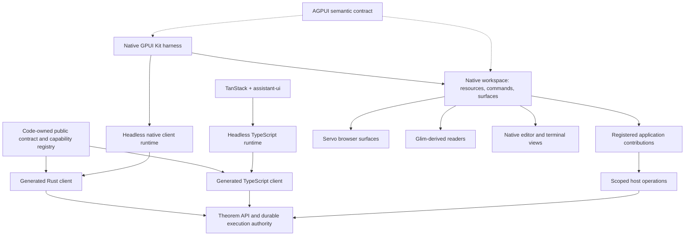

# Theorem native applications: foundation and harness build record

Date: 2026-10-25 (America/Detroit)  
Status: Architecture recommendation, revised to require SDK+ repair first; implementation and live acceptance have not begun.  
First application: Theorem harness inside the existing Frame/Platinum chrome.  
Prerequisite: [SDK+ repair and conformance](theorem-sdk-foundation.md).  
Evidence: [source audit](theorem-native-foundation-evidence.md).

## 1. Recommendation

First repair **SDK+**: the public capability contract, generated TypeScript and Rust clients, headless behavior and conformance gates. Then build the harness's visible interface in **Rust and the host's GPUI Kit**, backed by the proven headless client interface. Theorem's backend remains the authority for conversations and execution.

This deliberately changes one conclusion in the supplied prior advice: the existence of the old Rust conversation runtime is not sufficient reason to make it the foundation of another interface. Its host has explicit missing operations, and the inspected SDK and server source disagree about parts of the current API. First establish the actual working client/server contract. Then reuse the client implementation that passes it.

The foundation is the **proven public contract and client behavior plus native resource and action integration**. The user's SDK-first correction supersedes this record's initial choice of a TypeScript sidecar. Evaluate a generated Rust network client and headless runtime as the preferred native path; retain the TypeScript process as an alternative only if it wins on demonstrated behavior reuse and integration. Both must pass the same conformance scenarios. Client language does not determine whether the execution authority is local, hosted or embedded.

Use assistant-ui for the TanStack client. Its framework-independent core remains an option for TypeScript client behavior, but it is not the integration that makes Theorem reachable. Reuse existing orchestration and reducers where they pass the repaired contract; do not make a particular UI runtime a prerequisite for SDK access.

Preserve the current chrome, docking, focus routing, appearance, Servo composition, and browser profile behavior. Compose a new harness surface using those conventions. Reuse old native widgets only after they prove useful on this dependency graph and fit this product's interface.

### Product commitments

- Frame/Platinum remains usable as a browser with autonomous agents disabled and without initializing harness execution or an optional client process.
- Theorem desktop can launch its harness, documents, and tools without installing or launching the browser product. Share native source modules and contracts, not a dependency on the other application's executable.
- The TanStack web application continues. No GPUI-to-web port is required by this decision.
- Application services such as files, documents, terminals, and language services are independent of turning AI on. Calls may still require an available service and authentication.
- Applications contribute to Theorem's existing manifest and operation owners. Native, Shell, web, and worker implementations may share an application identity.
- SDK+ repair is the first workstream; the harness is its first native application integration. Glim, the IDE, and generated applications remain part of the architecture and build sequence.

## 2. What the investigation changes

The user's report that the assistant-ui frontend worked while earlier native interfaces did not is significant evidence about development outcomes. It does not isolate the cause. Source inspection gives several concrete variables to test:

| Finding | Consequence |
| --- | --- |
| Theorem-UI uses the SDK, a same-origin proxy, and explicit bootstrap/revision/reconnection logic. | Reusing the assistant-ui package alone does not reuse this integration. |
| The old native transport uses an authority URL and private token-file configuration, plus identity admission. | Browser login/proxy success does not establish native authentication success. |
| The native controller refuses message editing; regeneration can fork locally without starting the new run. | A rendered button or a runtime unit test does not prove the operation works. |
| SDK 0.4.0 describes a text-based message-send operation returning a run; the inspected server router accepts message parts and separately links runs. | Client/server provenance is a prerequisite. No frontend library can fix a mismatched deployment contract. |
| SDK edit/retry routes are absent from the inspected chat router. The SDK extension API references a server file absent from that commit. | SDK declarations establish an intended client surface, not deployed availability. |
| Frame has working integration source for a distinct GPUI Kit 0.8.0 dependency graph; AGPUI and older Theorem views use another graph. | Transplanting the old shell can add dependency and visual incompatibility without repairing transport. |
| Renderer-free AGPUI semantic and surface protocols already exist. | Agent inspectability can be retained without adopting the old visual application. |

These findings support **contract drift, authentication differences, and incomplete wiring as plausible causes**. They do not prove the historical root cause or describe the currently deployed server. This session did not run a model, authenticate to a deployment, or reproduce the old failures.

## 3. Architecture and ownership

The diagram shows the preferred Rust/TypeScript client split after SDK+ repair, not an implemented native client. The clients share backend identity, contract and conformance behavior; they do not share one process or every UI state object. A TypeScript sidecar remains an alternative adapter behind the same native session interface if evidence justifies it.

| State or behavior | Owner |
| --- | --- |
| Authenticated account, tenant and capability decisions | Theorem authentication and operation owners |
| Threads, branches, accepted messages, runs, approvals, artifacts and durable event history | Theorem backend |
| Connection, reads, command admission, resumption cursor and canonical client projection | Session module |
| Draft text and attachments before submission | Native draft model, scoped to account/project/thread; session module admits uploads and submissions |
| Focus, selection, expanded cards, scroll anchor, window geometry | GPUI views and workspace |
| Resource identity, document revision, save and conflict rules | Existing resource/document authority; local-file provider for standalone local resources |
| Terminal processes and PTYs | Terminal host, independently of attached views |
| Installed application manifests and grants | Existing Theorem app lifecycle; local built-in registrations must not require an agent run |
| Script view descriptions and callbacks | Application presentation runtime |
| Actual visible semantic nodes and action receipts | Native materializer/controls using AGPUI contracts |

There is one authoritative durable writer for each domain. A transcript projection is not a second message database. A file preview is not another editable copy. A plugin is not granted authority because its manifest requests it.

### Session interface

Keep this a deep module with a small interface: **connect to an admitted environment, observe a scoped projection, dispatch a typed intent, and detach an observer**. Method names are proposed, not existing SDK exports. Use explicit intent variants rather than a stringly typed arbitrary RPC escape hatch.

The projection includes connection state, account/project/thread/branch identity, ordered messages and parts, run lifecycle, pending approvals, attachments, resources, available actions, and typed failures. Preserve native Theorem data that has no assistant-ui equivalent; provide a generic readable fallback for unknown part types.

Intents must cover thread creation/selection/rename/archive/delete, send, stop, edit, regenerate, branch selection, upload/remove attachment, approval decisions, context attachment, and resource opening. Feedback and individual tool retry are available only when their operation owner supports them; distinguish a whole-turn retry from repeating one tool.

Views derive enabled actions and explanatory unavailable states from the projection. They do not infer successful execution from optimistic UI changes.

### Execution placement and optional sidecar

For the preferred Rust path, network and reduction work runs off the UI thread and publishes through GPUI's normal executor/entity mechanisms. Reuse maintained transport/stream libraries and generated wire models. The client connects to an explicitly admitted local or hosted authority; it does not become a second backend by being written in Rust. The existing embedded `theorem-harness` API is not equivalent to the complete network execution path.

The following requirements apply if the TypeScript sidecar alternative is selected after SDK+ conformance:

- Start with the SDK's documented Node 20+ execution environment, bundled and pinned for distribution. Bun is an alternative only after the same package, streams, shutdown, and packaging checks pass. Theia's use of Bun is not evidence that this new process works on Bun.
- Start the session process lazily when the harness is opened. One process may serve multiple thread subscriptions for one admitted profile. Account/profile changes retire subscriptions and reject late replies.
- Use private child-process pipes and a versioned typed protocol. Handshake on protocol, schema and feature support. Keep logs on stderr and protocol traffic separate. No localhost HTTP listener is needed just to connect two local processes.
- At implementation, reuse an established RPC/framing library and schema generation; do not write a JSON parser, SSE decoder, or generic RPC framework. Audit the existing AGPUI call/event envelopes and process transport before adding another equivalent mechanism. Domain session projections must not masquerade as AGPUI visual-node snapshots or claim the existing `NativeQuickJs` profile describes Node.
- Put authentication, SDK calls, retries and event reconciliation in the session module. Rust owns native presentation and host resource operations. Avoid serializing an entire transcript on every token: send keyed changes or batched projection revisions, with full snapshots for recovery.
- Bound messages and queues. A slow view may coalesce cumulative text updates but cannot discard approval, receipt, or terminal run-state transitions. If the observer loses history, explicitly resynchronize.
- Restarting the client process reattaches to durable work. It must never resend a possibly accepted mutation under a new idempotency key. Keep unresolved command identity/payload in a small recoverable outbox using existing storage machinery; clear only after reconciliation.
- IPC loss, hiding a panel, switching threads, and closing a window detach observers. Only an explicit stop intent requests backend cancellation. Application exit terminates the local client process; backend run survival depends on the backend, not that child process.

The extra runtime adds packaging, process supervision, IPC, and a projection adapter. Select it only when measured reuse/integration benefits justify those costs. Record cold start, memory, event-to-paint latency, and recovery under load for the chosen native path. A compiled client still needs deployed-version checks; compile-time typing cannot certify a separate server.

## 4. Assistant-ui, direct Rust, and Shell

| Approach | What it reuses | Remaining work | Decision |
| --- | --- | --- | --- |
| GPUI + generated Rust client and headless runtime | Repaired public contract and selected existing Rust behavior | Generated transport, complete headless behavior, authentication and parity | Preferred native candidate after SDK+ gates |
| GPUI + headless TypeScript SDK session module | Repaired TypeScript SDK and web orchestration | Extract browser assumptions, bridge, native widgets, packaging | Alternative if evidence justifies the extra process |
| GPUI + assistant-ui core in that process | Additional client interaction/runtime behavior | Headless setup, pinning, native binding, durable-state mapping | Use where demonstrated to replace needed behavior; not a backend fix |
| GPUI + old native controller unchanged | Existing Rust transport and reducers | Known missing operations and contract alignment | Not an accepted implementation of the repaired SDK |
| Shell-authored harness + headless session module | TypeScript view authoring and hot reload | Native control coverage, extension runtime compatibility, isolation | Useful future presentation; essential harness controls start compiled |
| Existing assistant-ui React UI in Servo | Existing web interface | Web compatibility, authentication, resource bridge | Reference/fallback surface, not completion of the native interface |
| React components directly rendered by GPUI Shell | No supported drop-in renderer found in inspected sources | Custom renderer plus DOM-dependent behavior | Do not make this the foundation |

Current assistant-ui has a framework-independent core, framework-neutral store entry, and non-React bindings. Some runtime constructors are exposed through `core/internal`; the documentation cautions about stability, and React-less bundling uses standalone shims. The existing Theorem web path uses `useLocalRuntime` and `useRemoteThreadListRuntime`, not ExternalStoreRuntime. Preserve that working client while evaluating changes. [Assistant-ui sources][aui-core] [Headless binding example][aui-vue]

If the native session module adopts assistant-ui, use it as the sole client runtime for the behavior it owns. Do not stack it over the old Rust conversation runtime and synchronize two client branch/run state machines. When Theorem owns the state, an external-store projection is the conceptual fit, but it needs a real integration test and cannot be assumed to be a drop-in conversion of the present adapter.

Do not upgrade Frame's GPUI graph just to follow current Shell documentation. The installed 0.8.0 component source already includes `Message`, `MessageScroller`, attachments, input and Markdown machinery. Use those before inventing chat primitives. The old app layout is not a design requirement.

## 5. Runtime invariants that prevent another disconnected frontend

1. **Bootstrap before mutation.** Establish endpoint, protocol, identity, tenant, project, and actual capabilities. A browser cookie is not a native bearer. Missing identity produces a useful connection state, never an invented tenant.
2. **One send is one admitted turn.** Submit the new turn only. Preserve its command key and expected revision until the server outcome is known. Do not replay the entire assistant-ui transcript to the backend.
3. **Separate transport recovery from command retry.** Stream disconnection reopens observation from the last accepted cursor. Ambiguous mutation failure reconciles the original request. Revision conflicts preserve the draft and obtain a fresh snapshot; do not blindly replay a stale decision.
4. **Deduplicate by durable identity.** Track run ID, event sequence, message ID and part ID. The inspected SDK treats message parts as cumulative snapshots; applying them as token deltas duplicates content.
5. **Make snapshot/stream consistency explicit.** Establish a backend cursor/watermark or use a documented replay strategy. Detect gaps; fetch a canonical snapshot when the cursor expires. A dropped connection is not a completed run.
6. **Fence late work.** Every observer is scoped to account, authority, project, thread and local observer generation. Switching threads cannot put an old response into the new transcript. Run observation can continue without owning the active view.
7. **Cancel admitted work.** Stop during send must retain/recover the returned run handle and cancel that run. Aborting only the HTTP request can orphan work.
8. **Execute tools once, at their owner.** No client-side executor for a tool already executed by Theorem. Decisions name the durable approval, run, and tool call. Duplicate/stale decisions receive canonical receipts/refusals.
9. **Freeze context on submit.** Page URL alone is insufficient for a changing selection. Retain the admitted resource identity, revision/content reference, selection, and provenance. Changing tabs does not change a submitted run's context.
10. **Separate all revisions.** Thread revision, document revision, event cursor, view projection revision, and plugin epoch have different meanings. Retain each owner's types and conflict semantics.
11. **Authenticate resources too.** Artifact, upload, terminal and document handles are scoped to the admitted account/workspace. Opening a handle does not grant a plugin ambient file or credential access.
12. **Keep diagnosis visible.** A connection inspector reports sanitized endpoint/build/protocol information, current identity, request correlation IDs, last cursor, stream status and failures. It must never print tokens, private prompts, or file contents by default.

## 6. AGPUI without the old interface

Yes: use its renderer-free contract independently. `agpui-contract` defines semantic nodes, snapshots, actions, diffs and receipts without a GPUI dependency. Theorem also has `agpui-shell-protocol`, an out-of-process Shell host, a materializer and a plugin SDK. These are distinct pieces, not evidence that every native component is already wired. [Contract][agpui-contract] [Existing Shell specification][shell-spec]

Adapt the useful semantic publication to Frame's actual controls. Publish stable identities, roles, state, supported actions and visible revisions. Mouse, keyboard and agent actions must reach the same operation handler and return meaningful receipts. Preserve semantic identity when a view moves between docks; reject actions against replaced or hidden instances as appropriate.

Do not derive the visible UI from a semantic hash, expose raw backend execution as a widget callback, or import an incompatible GPUI fork just to retain this vocabulary. Audit current Rust type paths: the inspected code includes historical ownership/path changes. Pin a coherent source set before building. AGPUI semantic coverage supplements native accessibility and rendered tests; it does not prove either automatically.

## 7. Workspace, applications and the manifest

The native workspace should reuse Frame's `DockArea` integration. Add a surface interface around a concrete harness view and then a viewer: identity, title/icon, focus, contextual commands, resource/selection, dirty-close behavior, mount/detach, and versioned restore state. Let real implementations establish the interface before extracting a universal workspace framework.

Browser navigation remains browser-specific. A harness tab should not inherit an address bar, and an editor's close operation must honor unsaved edits. A surface ID identifies a presentation instance; a resource ID identifies the underlying work. Several surfaces can reference one resource.

### Extend the manifest already present

Theorem's `theorem-blocks::AppManifest` already has `app_id`, integer `version`, shapes, seed blocks, capability grants, surface templates, WASM modules, external MCP grants, contributions and attestations. Existing extension points include `pane.kind`, `composer.verb`, `toolbar.action`, `filing.rules` and `scene.domain`. Presentation packaging already distinguishes `agpui.surface.v1` and `web.overlay.v1`. Reuse their lifecycle, validation, grant and provenance owners. [Manifest][app-manifest] [Presentation contract][presentation]

Borrow Twenty's typed authoring and build-emitted manifest approach, not its platform-specific runtime or a second installation catalog. [Twenty concepts][twenty]

Proposed additions must be versioned extensions to those owners, with Rust and TypeScript types generated from the authoritative schema:

| Contract area | Required semantics |
| --- | --- |
| Compatibility | Required host/service/presentation schema versions and features; refuse unsupported executable targets before loading |
| Resource handlers | Resource kinds/media types, read/edit capabilities, deterministic viewer resolution, user's override |
| Presentation bindings | Compiled native registration, supported Shell artifact, embedded web target; explicit fallback and platform support |
| Actions | Stable operation identity, typed inputs/results, required scope, user-facing label; human and agent invoke the same owner |
| Context providers | Explicit selection and revision/provenance references, with cancellation and admission results |
| Packaging | Exact source revision, artifact digest, dependencies, publisher and applicable license/attribution |
| Persistence | Stable logical view/command IDs, versioned view state, migration and missing-plugin placeholders |
| Lifecycle | Install, grant, activate, update, rollback, disable, uninstall; revoke subscriptions/callbacks on retirement and preserve user documents |

Existing contribution IDs are content-derived. Add or bind stable logical view/action identities without silently redefining content hashes as permanent product identities. Keep the manifest's existing integer revision; introduce a separate schema or package version if needed rather than changing its meaning.

Compiled first-party applications use the same registration vocabulary but are shipped as native code, not dynamically loaded Rust libraries with an assumed stable ABI. Browser/basic local file operations must keep working without a model or a live harness client. Share the registration schema with a local built-in catalog; do not duplicate writable document authority or remote installation state.

### Shell execution and trust

Upstream GPUI Shell is still described as M0; its VM lives on the application thread and its remaining contribution registry is incomplete. Separate VMs do not establish OS process isolation. Its `check` command does not verify layout, painting, later interaction or asynchronous behavior. Host changes require script refresh rather than only a GPUI repaint. [Shell README][shell-readme] [Hosting][shell-hosting]

Use stock embedded Shell only for explicitly trusted, pinned presentation code within its tested limits. Arbitrary downloaded or agent-generated code needs the existing Theorem worker/materializer design evaluated and integrated, including resource limits, termination, capability enforcement and stale-callback rejection. The presence of the worker source is not a security or production acceptance result.

Stock GPUI Shell scripts and Theorem's `agpui.surface.v1` worker protocol are not interchangeable artifacts. Map the supported component/service subset and make unsupported APIs fail during packaging. Keep essential stop, reconnect and approval controls in the first-party native surface so an extension failure cannot remove them.

## 8. Viewer, IDE, terminal and website applications

**Glim:** adopt its services and extract suitable readers as a library; `glim-app` currently declares a binary. Align its GPUI Kit 0.7.1 and patches with Frame's 0.8.0 graph. Keep load cancellation, paging, and format-specific limitations. Route reads and writes through the resource authority, not a private viewer document store. Its macOS previews include PDFKit, AVKit, Quick Look and WebKit; adopting all readers is not a Servo-only renderer strategy. Retain those as explicit platform adapters or substitute per format after parity checks. [Glim manifest][glim] [Format support][glim-formats]

**IDE:** preserve Theia as the browser frontend. The inspected fork is browser-only over Theorem's document, terminal, language and SCM services; Bun is tooling, not a converter to native controls. Reuse those service contracts for a GPUI editor. Compile the editor and terminal views; use Shell for additional panels where appropriate. Monaco, arbitrary Theia widgets and VS Code webviews do not automatically become GPUI controls. Demonstrate shared document edits, per-client undo, save, conflicts, diagnostics at the right revision, reconnect and the same terminal session before claiming native IDE parity. [Theia integration][theia]

**Terminal:** reuse `theorem-terminal` and its `alacritty_terminal` engine as the starting candidate, then reconcile with the actual SDK terminal authority used by the IDE. Keep PTYs, emulator and process lifetime at one host; native views attach to its session. The existing local engine preserves a process after view detach but not after its final host owner exits. A multi-client/remote terminal needs the appropriate host channel; do not spawn a second local shell just to display a remote session. Ratatui builds programs that run in a terminal; Ratzilla presents such programs in a browser. Neither replaces PTY hosting and VT emulation for arbitrary interactive shells. [Terminal engine][terminal] [Ratatui backends][ratatui]

**Website applications:** expose three honest implementation targets: a saved Servo web application, a native lens over an API/extraction adapter, or a source-adapted application. Preserve origin/session identity, provenance and links. A manifest selects a known implementation; it does not convert DOM, server behavior or authentication into a native application. Build/adaptation jobs run outside the UI and installed deterministic features keep working with agents off.

## 9. Build sequence and acceptance

These are dependency-ordered gates for the requested foundation, not a reduction of the harness to a chat demo. **The SDK+ workstream S0–S6 precedes native harness construction.** This record specifies future implementation; all live rows below are **not run**.

Every gate uses `implementation_mode=real`, `substitution_allowed=false` for acceptance. Source review and fixtures may support development but cannot close a live row. Record actual commands, source/build IDs, sanitized receipts, resource IDs, and evidence paths when executing.

| Gate | Work and required evidence | Oracle class | Evidence now |
| --- | --- | --- | --- |
| SDK+: public client foundation | Complete the [SDK+ repair gates S0–S6](theorem-sdk-foundation.md): capability accounting, code-owned contracts, generated Rust/TS clients, headless behavior and bidirectional/live conformance. | Source/handler/schema conformance + installed clients + live backend/model | Partial source audit; implementation pending |
| G0: coherent baseline | Identify the actual server used by the functioning web app; pin UI, SDK tarball/hash, backend and GPUI graph. Reconcile send/edit/retry and extension contract drift. Probe identity and supported routes without fabricating readiness. | Live backend + source/build provenance | Source audit only; live required |
| G1: headless full run | From the reusable client module, authenticate, create/load a real thread, send, observe a real model/tool result, stop, reconnect, reload accepted history, and see it in the web client. Capture command keys, run IDs, cursors and receipts without secrets. | Live model + backend + two clients | Not run; live required |
| G2: native harness | Mount in Frame chrome. Full input/IME, selection/copy, streaming, tail following, history pagination, keyboard focus, cancellation, thread switching, errors, native accessibility and actual paint. Compare to the host's existing look. | Visible native UI + live backend | Not run; live required |
| G3: conversation operations | Uploads, resource context, pending approvals and elicitation, editing, regeneration, branch selection, model/execution configuration supported by the server, activity/delegation display, durable thread lifecycle. Unsupported operations show reasons. | Live operation receipts + native UI | Not run; live required |
| G4: recovery | Disconnect streams, stop while send is pending, restart the client, expire credentials/cursors, race thread switches, return stale approval responses and lose a mutation response. No duplicate execution, mixed threads, lost accepted messages or false completion. | Fault injection against real processes/backend | Not run; live required |
| G5: workspace task | Submit a captured page/file selection, run an actual tool/terminal operation, open its artifact in a registered viewer, return to the same thread in web/native, restore placements after app restart. | Live end-to-end + visible artifact | Not run; live required |
| G6: product independence | Browser works without harness execution/model or optional client process; standalone Theorem launches without browser product; documents and tools work with AI disabled; explicit unavailable remote-service behavior. | Packaged applications | Not run; live required |
| G7: application contract | One Glim-derived viewer and one Shell contribution use existing registration/grants. Verify install/update/disable/restore, grant revocation, stale callbacks and worker failure containment. | Real package + process + visible UI | Not run; live required |
| G8: IDE and adaptation | Shared native/web document and terminal tests; website-to-workspace targets distinguished; one source-adapted plugin survives restart and works with agents disabled. | Live multi-client + packaged contribution | Not run; live required |

SDK+ S0 is the first implementation target. G0/G1 then bind the repaired SDK to the chosen native product host before a large UI build; G2–G8 remain required for their corresponding product claims. Reuse SDK acceptance evidence where the same pinned behavior is exercised, and add host-specific checks rather than duplicating the whole suite. An SDK smoke test that skips for missing configuration does not pass G1. A successful model reply alone does not pass the tool, approval, recovery, artifact or packaging gates.

For the harness, retain a single end-to-end executable acceptance scenario spanning bootstrap → thread → real run → tool/approval → artifact → reload in both clients. Add negative scenarios around the same interface, not a parallel test-only transport. Use GPUI's existing headless/render tools and AGPUI semantic actions alongside visible checks; do not equate semantic snapshots with rendered acceptance.

### Repository placement and reuse

| Location | Intended responsibility |
| --- | --- |
| Current Frame checkout | Native harness composition, host resources, dock integration, chrome regression evidence |
| Existing Theorem capability registry and owning public contract types | Exposure decisions, deterministic schema exports and bidirectional drift enforcement |
| `Theorem/packages/theorem-sdk` plus the native client location chosen during SDK+ | Generated TypeScript/Rust bindings and reusable headless behavior; no UI framework dependency in headless entries |
| Existing Theorem API/resource owners | Contract alignment, missing operations, receipts and backend acceptance |
| Existing `theorem-blocks`, AGPUI protocol/SDK/worker/materializer | Manifest and presentation integration; preserve ownership instead of making a second framework |
| Native shared modules extracted from real Frame/Theorem consumers | Standalone Theorem entry point after the harness surface proves the interface |

Names and crate boundaries should follow the pinned repositories at implementation time. Do not create placeholder packages for every box in the diagram. A small custom session projection and host adapter are necessary because no inspected library supplies Theorem's durable contract directly to GPUI; parsers, transport, UI primitives, terminal emulation and document algorithms should be reused.

## 10. Outstanding decisions and next concrete step

Begin SDK+ S0 without deciding every plugin renderer or IDE feature. The required scope now includes full public capability accounting and generated Rust/TypeScript clients, as well as the working deployment's provenance, matching API contract, native authentication, package compatibility and live cross-client behavior. Preserve the current shell while repairing those foundations.

Next: follow [SDK+ S0–S6](theorem-sdk-foundation.md). Establish the inventory and matched source/build baseline, extend existing capability projection policy, repair owner types and handlers, generate both clients and prove their headless behavior. Select the native adapter from that evidence, then connect one GPUI harness surface. The existing SDK smoke test is a probe in this sequence, not its completion criterion.

This documentation session changed no runtime code, installed no dependencies, started no model runs, and performed no deployment. The existing dirty Theorem checkout and conflicted Agentic-GPUI checkout were inspected read-only. No user credential values were read for the architecture audit.

[aui-core]: https://github.com/assistant-ui/assistant-ui/blob/main/packages/core/package.json
[aui-vue]: https://github.com/assistant-ui/assistant-ui/blob/main/packages/vue/README.md
[agpui-contract]: https://github.com/Travis-Gilbert/Agentic-GPUI/blob/main/crates/agpui-contract/Cargo.toml
[shell-spec]: https://github.com/Travis-Gilbert/Theorem/blob/8e151d510722c2946f3f1cf63eb5a73e06c1695b/docs/plans/agpui-shell/SPEC-AGPUI-SHELL-1.0.md
[app-manifest]: https://github.com/Travis-Gilbert/Theorem/blob/8e151d510722c2946f3f1cf63eb5a73e06c1695b/rustyredcore_THG/crates/theorem-blocks/src/app.rs
[presentation]: https://github.com/Travis-Gilbert/Theorem/blob/8e151d510722c2946f3f1cf63eb5a73e06c1695b/rustyredcore_THG/crates/theorem-blocks/src/presentation.rs
[twenty]: https://docs.twenty.com/developers/extend/apps/getting-started/concepts
[shell-readme]: https://github.com/longbridge/gpui-kit/blob/main/crates/shell/README.md
[shell-hosting]: https://gpui-kit.com/shell/hosting/
[glim]: https://github.com/glimapp/glim/blob/main/Cargo.toml
[glim-formats]: https://github.com/glimapp/glim/blob/main/docs/file-format-support.md
[theia]: https://github.com/Travis-Gilbert/Theorem-UI/blob/38e723006c8419a305e7ed443180e6c5e64bed81/ide/README.md
[terminal]: https://github.com/Travis-Gilbert/Theorem/blob/8e151d510722c2946f3f1cf63eb5a73e06c1695b/apps/theoremweb/crates/terminal/README.md
[ratatui]: https://github.com/ratatui/ratatui/blob/main/ARCHITECTURE.md
