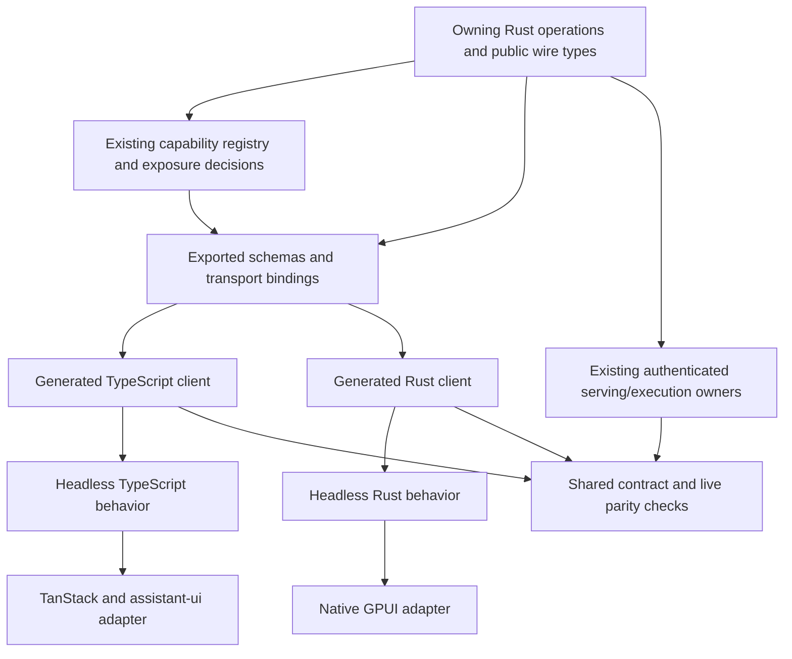

# SDK+ repair: prerequisite for native Theorem applications

Date: 2026-10-25 (America/Detroit)  
Status: Implementation in progress in `/Volumes/SSD Samsung/theorem-sdk-foundation` on `Travis-Gilbert/sdk-foundation-20261025`; full SDK+ and live acceptance remain pending.  
Consumer: [native foundation record](theorem-native-foundation.md).  
Source baseline: Theorem `8e151d510722c2946f3f1cf63eb5a73e06c1695b`.

## 1. Outcome and scope

Repair **SDK+** before building the harness interface: Theorem's public capability contract, generated TypeScript and Rust clients, headless client behavior, capability discovery and conformance evidence.

The existing TypeScript package is one output of this foundation. SDK+ must let native GPUI, the web application, CLI consumers and application contributions use supported capabilities without reconstructing operation shapes or execution rules. A broad list of generated methods is insufficient when their arguments/results are unknown, their handlers are missing, or they cannot recover a real run.

The repair covers the full declared public surface. Inventory every capability family, determine explicit client exposure, strengthen its owning contracts, and provide the required projections and verification. The harness's conversation flow is the first integration oracle, not the definition of SDK completeness. Planned capabilities remain explicitly planned; do not advertise implementation that does not exist or mark missing required work NotApplicable to obtain a green report.

The user explicitly added the full Files API to this work: all 22 operations under
`/api/files/v1`, including content, entries, directories, moves, events, links,
backlinks, graph, resolve, search, tags, properties, settings, vault, promotions,
suggestions and decisions, and OKF imports/exports. Consolidate its existing
native semantic owner, derive both clients' payloads from the Rust wire types,
and verify read-only behavior, preconditions, idempotent writes, event polling,
and compatibility with the web workspace adapter. A same-origin proxy route or
merged UI PR alone does not establish native backend or deployment availability.
Theorem UI PR #16 is merged; deployment acceptance remains separate. Current
evidence and blockers belong to the Theorem checkout's
`docs/plans/sdk-foundation/IMPLEMENTATION.md` and `status.json`.

Files checkpoint (2026-10-26): the candidate exports owner-derived payloads to
TypeScript and Rust. Fifty Files owner tests and five actual-router tests pass;
the SDK exercises all 22 operations against the shipping native process, with
promotion and decision coverage limited to typed refusal paths in that process
test. Acknowledged content, events and idempotent receipts survive SIGKILL and
restart with MCP disabled. The UI workspace adapter compiles against the
candidate. TypeScript and Rust also read each other's files against that process,
including Rust-written content after restart. These checks do not establish deployed availability, rendered UI
acceptance, or completion of the remaining SDK+ scope.

This is a dependency change to the overall plan:

**SDK+ repair and conformance → headless native/web execution proof → GPUI harness → workspace applications.**

## 2. Verified starting point

The two new supplied notes were checked against the pinned source. Counts use parsed OpenAPI operations, not README totals or regex estimates of all server routes.

| Measure | Verified count | Definition |
| --- | ---: | --- |
| SDK HTTP path templates | 246 | Keys in `openapi.paths` |
| SDK HTTP operations | 261 | HTTP method entries in those paths |
| Operations attributed to the IDE HTTP host | 203 | `x-theorem-source = apps/theorem-ide-host/src/http.rs` |
| Named operations projected from the IDE registry | 188 | Entries carrying `x-theorem-operation` |
| Of those 188, requests using `NativeArguments` | 175 | Direct JSON request schema reference |
| Of those 188, successful responses using `NativeResult` | 186 | Direct successful response schema reference |

Thus 203 and 188 count different things; neither is a completeness denominator for Theorem. These measurements are tied to the inspected commit and must be regenerated for the implementation baseline. [OpenAPI][openapi]

Other confirmed facts:

- Fern already generates the TypeScript transport. The updater manually constructs schemas and extracts IDE operation names by splitting Rust source text and applying a regex. It does not derive most public payloads from the actual Rust request/result types. [Updater][updater]
- `RunEvent` uses string discriminators and an open JSON payload; `RunCommand` admits strings and optional fields rather than command-specific variants. `NativeArguments` and `NativeResult` intentionally preserve generic JSON.
- The current contract test checks SDK entries against strings in their named source owners. It neither enumerates omitted public capabilities nor proves that serialized requests/results match the handler. It can fail on missing owners; its existence is not evidence of a passing suite. [Contract test][contract-test]
- The earlier audit found concrete send-contract disagreement, missing edit/retry router entries and a missing extension handler source. Preserve those findings as baseline failures. [Evidence E4](theorem-native-foundation-evidence.md#e4-clientserver-contract-drift-is-visible-in-one-pinned-source-snapshot)
- `theorem-capability-registry` already owns implementation, schema references, effects, idempotency, access, exposure, maturity and projection intent. Its current projections and inventory surfaces omit HTTP/SDK clients. Its source catalog explicitly emits `registry_complete: false`. [Registry][registry] [Inventory][inventory] [Exporter][exporter]
- `OperationDeclaration::typed<A, O>` and `NativeOperation::typed` already demonstrate Schemars-derived types and executor binding. The inspected declaration list contains only `web_search`; extend the pattern without claiming it covers all owners. [Typed operations][operations]
- `theorem-harness` is an embedded GraphStore-backed API. `RunHandle::start` appends `RUN.CREATED`; this alone does not invoke the complete model/tool execution path. It is not the missing Rust network client. [Embedded API][embedded] [Run implementation][run]

The supplied claim of 16 missing routes and estimates of total backend routes were not independently certified here. Retain them as investigation leads. Registered routes, dynamic dispatch, feature flags and actual deployment builds need explicit reconciliation; text searches alone cannot prove the entire live surface.

## 3. Architecture

Public types are deliberate projections, not exports of private storage structs. The operation's owner defines its public semantics and binds the handler to them. The registry identifies and accounts for those definitions; it must not become a second handwritten payload catalog.

Generation produces transport, serialization and types. It does not generate correct recovery, cancellation, concurrency, authentication UX or a working backend. Keep those behaviors in headless modules and prove them through shared scenarios. Reuse existing `WorkspaceLive`, `DocumentSession`, `TerminalChannel`, event reducers and useful web/native orchestration before writing replacements.

### Native client language and backend placement are separate choices

Prefer evaluating a Rust network client and headless runtime for GPUI once SDK+ exists. Keep TypeScript for the web. The previous unconditional TypeScript sidecar recommendation is superseded; retain it only as an alternative if reuse of its behavior materially outweighs IPC and packaging and the same acceptance gates pass.

A Rust network client can connect to a hosted service or a local agent daemon without embedding the whole backend in Frame. An embedded adapter is a separate product decision about ownership, lifetime, resources and authentication. It must preserve the same admission/execution semantics. Do not create a second conversation store merely to avoid HTTP.

Neither Rust generation nor TypeScript generation prevents a separately deployed server from drifting. Both require schema compatibility checks and real handler conformance. Local/hosted/hybrid placement must be recorded per authority; hybrid synchronization is not implied by the presence of two client implementations. Use the current working web authority for initial parity once its identity is established. This does not commit the final product to remote-only execution.

## 4. Complete capability accounting

Extend the existing registry and inventory reconciler. Build the denominator from implementation registrations, router/operation registrations, GraphQL schema exports, MCP catalogs, native declarations and entrypoint inventories, rather than from the SDK under test. Normalize aliases/transports to one canonical capability identity; one operation may have several bindings and one dispatch route may serve many operations.

Each row needs owner and feature conditions; public input/output/error/event schema references and resolved digests; effect/access/idempotency semantics; transport binding; TypeScript/Rust projection policy; implementation/maturity state; runtime availability; and evidence references. Record internal/deprecated/not-applicable entries with a checkable rationale. Unknown entries remain unresolved and block a completeness claim.

Separate public exposure from deployment availability. A supported capability may be denied by the current user's grants, disabled by configuration, unavailable on a platform or temporarily unhealthy. Discovery must distinguish those conditions from absent implementation and unsupported contract version. Do not reveal another tenant's resources through discovery.

| Family | Coverage to account for |
| --- | --- |
| Conversations and execution | Projects, threads, branches, messages, heads/models, delegation, runs, approvals/elicitation, artifacts, uploads, cancellation and replay |
| Coordination and planning | Goals, plans, tasks, claims, jobs, rooms, handoffs and their lifecycle events |
| Memory and context | Recall, retained material, provenance, context inspection, identity and bindings |
| Skills and encoding | Packs, compilation stages, lifecycle, publication, checkers and verification receipts |
| Browser participation | Host/tab identity, perception, selections, navigation generations, actions, approvals, interruption and capture receipts |
| Documents and workspaces | Records, documents, Spaces, files, editing sessions, terminal channels, language/SCM/IDE operations, layouts and application extensions |
| Graph and structured data | Supported reads, relationships, queries, transactions and provenance |
| Learning and policy | Supported feedback/evaluation, policy versions, proposals and admission gates |
| Procedural capabilities | Domain schemas, job/refinement events, confidence/evidence and typed artifact references |

This table defines the inventory's breadth, not a claim that every listed capability is already implemented or approved for public access. Preserve explicit planned rows and turn required gaps into implementation work. No automatic publication of internal/admin surfaces is authorized by SDK generation.

The broad Harness GraphQL schema currently travels through MCP tools; it is not automatically the gateway's HTTP GraphQL schema. Reuse the semantic owners and explicitly bind product-client access. Do not quietly make `/mcp` the desktop's private data plane or send generated GraphQL requests to an unrelated schema. [Harness GraphQL transport][graphql]

## 5. Dependency-ordered repair work

### S0 — Establish the baseline and coverage ledger

Resolve the code and package artifacts actually used by the functioning web application. Pin backend, SDK artifact/hash, web client and registry/schema versions. Identify generated versus handwritten files, test skips, unmerged dependencies and missing handler owners. Preserve the dirty sibling checkout; implementation needs an appropriate current checkout with all applicable instructions read.

Produce a machine-readable inventory and a generated human report covering the families above. Record each observed mismatch as a failing case with its owner. Where source and deployment differ, name both rather than attributing deployed behavior to a convenient main-branch commit.

### S1 — Add explicit SDK projection policy to existing owners

Extend capability descriptors, schema/reference validation, inventory surfaces, source collectors and drift checks together. Account for TypeScript and Rust availability and transport mappings without conflating a language binding with an HTTP route. Preserve the distinction between Required and NotApplicable; add no silent default that classifies existing capabilities as intentionally excluded.

Descriptors are content-addressed and currently deny unknown fields. Version and migrate the registry schema, hashes, fixtures and readers deliberately. An old descriptor must not be silently reinterpreted as covering SDK clients. Schema references must resolve to exported definitions; a `rust://...` string alone is not a generated contract.

### S2 — Repair the code-owned contract and serving implementation

Define public request, response, error and event types beside the owning behavior; bind handler serialization and schema export to those definitions. Extend the existing Schemars/typed-operation machinery where suitable. Use established schema/export tooling for other owners. Replace source-text scraping and duplicate schema construction with deterministic exports.

Start with conversation admission, run commands/events, approvals, coordination and browser participation, then complete the required inventory. Known core variants get discriminated payloads. Preserve legitimate dynamic plugin data through an explicit extension variant with schema identity/version and validation. Unknown future variants must survive observation without being acted on as known executable commands.

Resolve the existing send mismatch by selecting and implementing the intended high-level turn operation, including full admission and model/tool execution. Preserve a lower-level append operation only under an explicit compatible contract; do not confuse persistence with execution. Implement or reconcile required edit/retry and extension handlers. Do not delete required SDK methods merely to make the coverage test pass.

Retain owner-specific revisions, receipts, cancellation, error/refusal and idempotency semantics. Specify cumulative versus delta parts, sequence scope, terminal outcomes and snapshot watermarks. Preserve integer precision across Rust/JavaScript and explicit Unicode scalar, UTF-8 byte and UTF-16 offset conversions where relevant. Wire compatibility tests must cover serde tags/renames/defaults and optional versus null values.

### S3 — Generate both clients reproducibly

Keep the existing pinned Fern TypeScript pipeline. Select and verify a suitable Rust generator against the exported contract and required streaming/auth/error behavior, checking its actual availability and license before making it mandatory. Reuse generated models and maintained HTTP/SSE libraries; do not hand-roll clients or parsers to bypass an unsupported generator feature.

Record generator/runtime pins, configuration, schema hash and package provenance. Regeneration from a clean source export must produce no unexplained diff. Generated sources remain generated; supported custom behavior lives in explicit handwritten modules. Verify distribution artifacts as installed consumers, not only workspace-relative imports.

A generated method must preserve headers, path/body identities, effect-specific retry policy and receipt/error bodies. OpenAPI generation alone does not imply that resumable SSE, bidirectional terminal channels or alternate transports are implemented. Add the necessary typed adapters and test them through the same owner.

### S4 — Complete headless behavior

Provide framework-independent connection, observation and command behavior. No React, GPUI, DOM or browser-global dependency is required to exercise a complete conversation. Assistant-ui and GPUI become adapters over that interface.

Cover snapshot/event alignment, idempotent event reduction, duplicate/gap recovery, multi-subscriber state, thread-switch fencing, durable pending command identity, approval persistence, authentication expiry, cancellation during admission and recovery after client restart. Detaching a view must not cancel a run. The old native controller and web adapter are reuse candidates and differential references, not assumed specifications.

Use shared conformance traces and live scenarios for Rust and TypeScript. Do not demand byte-identical language-internal state; compare canonical IDs, accepted operations, outcomes, revisions and receipts. Avoid independently inventing two sets of conversation semantics.

Browser participation additionally binds each operation to the visible host/tab and navigation generation. Human interruption stops scheduling agent input locally before the server round trip; reconcile the outcome of already-dispatched input. A generic browser tool success is insufficient if it acted on another browser instance.

### S5 — Enforce coverage and compatibility in both directions

CI must detect:

1. Required public capability missing from either declared client target.
2. Client method lacking an admitted implementation/transport binding.
3. Unresolved public schema reference or generic payload replacing a stable declared type.
4. Actual handler serialization disagreeing with exported/generated models.
5. New implementation or registration lacking an exposure decision.
6. Schema/package drift, incompatible changes without migration, or stale runtime capability advertisements.

Do not compare only route strings. Exercise actual handlers, serialization and feature-conditioned registrations. Runtime capability observations supplement source coverage and identify the build being tested. Keep optional/dynamic extensions explicit so legitimate open schemas do not produce false completeness or false failures.

### S6 — Prove SDK+ before native interface construction

Run installed Rust and TypeScript clients against the same matched authority. Complete a real model/tool run, handle approval and interruption, reconnect and reopen it across clients. Exercise the required resource families with their real owners and effect-appropriate oracles. Missing credentials or binaries produce blocked/skipped evidence, never a passing live gate.

Record source, schema and package IDs, sanitized request/receipt/run references, tested runtime profile, evidence class and failures. Use disposable test resources with explicit cleanup where appropriate; retain the evidence. Full SDK+ completion requires all required inventory rows, not only a successful chat path.

## 6. Acceptance and definition of done

Each full gate below remains open; partial implementation and evidence are recorded explicitly. `implementation_mode=real`; `substitution_allowed=false` for closing live requirements. Fixtures and deterministic traces support development but cannot substitute for the corresponding real owner/model/process oracle.

| Gate | Oracle class | Completion condition | Evidence class now | Live oracle required |
| --- | --- | --- | --- | --- |
| S0 inventory | Source/compiled registrations and deployment provenance | Every discovered family/operation classified; source/deployment mismatches recorded; no unknown exposure rows | Partial source audit | Yes, for deployment identity |
| S1 policy/export | Registry and schema conformance | Explicit projection decisions, resolvable schemas, tested migration and no duplicate authoritative catalog | Registry/migration checks pass; 93 projection decisions remain unresolved | No |
| S2 contract/handlers | Actual handlers and canonical serialization | Required commands/events/operations typed and implemented; baseline mismatches resolved without bypassing admission | Selected owner/router tests and live handlers pass; stable public types remain incomplete | Yes, for served behavior |
| S3 clients | Reproducible generation and installed package tests | Rust/TS packages generated and usable; errors, streams and retries preserve contract | Installed TS/Rust checks pass; complete public contract coverage remains open | Yes, for transport behavior |
| S4 runtime | Shared traces plus real failure/recovery scenarios | Both languages preserve identity, state, approvals and command semantics across failure | Shared traces and cross-client recovery pass; latest admission-cancel settlement repair awaits live proof | Yes |
| S5 coverage | Bidirectional drift gate | No missing required projection, fictional method or unclassified implementation; compatibility failures detected | Executed and failing: unclassified capabilities and required projections remain | Yes, for advertised readiness |
| S6 acceptance | Live backend/model/resources and multiple clients | Required inventory passes; real conversation/tool/approval/recovery/browser receipt journey; evidence retained | Current matched core/resource checkpoint passes; historical failures retained; full family/browser proof remains open | Yes |

Completeness is measured against required canonical capabilities by client target, with exclusions and unresolved/planned rows shown separately. Counts of HTTP routes, generated methods or passing mock tests are not proxies for that denominator. A feature may be known in the schema while unavailable on a particular connection; the client must explain why.

The existing SDK live test is an initial probe, not the full acceptance suite. It does not establish all capability families, native browser participation, or both generated clients. Native foundation G0/G1 become consumers of this evidence after SDK+ repair; they must not conceal remaining required SDK work.

## 7. Session record and next action

The user explicitly moved SDK+ repair ahead of native application work. This record defines that prerequisite and removes the prior assumption that a TypeScript sidecar is the chosen native foundation. The current session updates documentation and verifies source facts; it does not claim SDK code has been repaired.

Next implementation action: close the unresolved owner/projection decisions and stable public wire exports against the existing inventory. Shipping-server admission cancellation and the Link threshold-policy SDK routes now pass the matched live checkpoint below. Continue through the required resource-family and visible host/tab/navigation receipt oracles before claiming S0–S6 complete or beginning substantial harness UI construction. Choose the native client from conformance evidence and packaging requirements.

[openapi]: https://github.com/Travis-Gilbert/Theorem/blob/8e151d510722c2946f3f1cf63eb5a73e06c1695b/packages/theorem-sdk/fern/openapi.json
[updater]: https://github.com/Travis-Gilbert/Theorem/blob/8e151d510722c2946f3f1cf63eb5a73e06c1695b/packages/theorem-sdk/scripts/update-environment-contract.mjs
[contract-test]: https://github.com/Travis-Gilbert/Theorem/blob/8e151d510722c2946f3f1cf63eb5a73e06c1695b/packages/theorem-sdk/tests/contract.test.ts
[registry]: https://github.com/Travis-Gilbert/Theorem/blob/8e151d510722c2946f3f1cf63eb5a73e06c1695b/rustyredcore_THG/crates/capability/theorem-capability-registry/src/lib.rs
[inventory]: https://github.com/Travis-Gilbert/Theorem/blob/8e151d510722c2946f3f1cf63eb5a73e06c1695b/rustyredcore_THG/crates/capability/theorem-capability-registry/src/inventory.rs
[exporter]: https://github.com/Travis-Gilbert/Theorem/blob/8e151d510722c2946f3f1cf63eb5a73e06c1695b/rustyredcore_THG/crates/rustyred-thg-mcp/src/lib.rs
[operations]: https://github.com/Travis-Gilbert/Theorem/blob/8e151d510722c2946f3f1cf63eb5a73e06c1695b/rustyredcore_THG/crates/agent/src/operations.rs
[embedded]: https://github.com/Travis-Gilbert/Theorem/blob/8e151d510722c2946f3f1cf63eb5a73e06c1695b/rustyredcore_THG/crates/theorem-harness/src/lib.rs
[run]: https://github.com/Travis-Gilbert/Theorem/blob/8e151d510722c2946f3f1cf63eb5a73e06c1695b/rustyredcore_THG/crates/theorem-harness/src/run.rs
[graphql]: https://github.com/Travis-Gilbert/Theorem/blob/8e151d510722c2946f3f1cf63eb5a73e06c1695b/rustyredcore_THG/crates/rustyred-thg-mcp/src/graphql/mod.rs

### 2026-10-26 continuation: real conversation/ACP checkpoint

The consolidated SDK branch has now passed a real local journey using installed
TypeScript and Rust clients: model turns in both languages, shared durable journal
readback, SIGKILL recovery, pending OpenCode approval reopened by a replacement
client, an approved file write verified on disk, agent-process cleanup, and
TypeScript cancellation during admission followed by restart. Evidence is retained
in the Theorem checkout's `docs/plans/sdk-foundation/evidence/native-conversation-acp-initial.json`.
This is a partial S6 checkpoint, not full SDK+ or deployment acceptance.

Continuation work adds Rust observer race/retry repairs, atomic extension mutation
receipts using existing core graph staging, and native async-owner identity fixes.
Final rebuilt-artifact/resource checks are in progress. Twelve internal provider
handle activation descriptors are now explicitly excluded from network projection;
their public operations remain in scope. Thirty-one other canonical descriptors
still have 93 unresolved SDK projection decisions. Full public-family accounting,
stable owner-derived payload coverage, visible-browser binding/interruption and
all-family live acceptance remain required. The implementation record remains the
source for current evidence, failures and next steps.

### 2026-10-26 continuation: current installed artifact verification

The current candidate schema is
`6279b61e06288286a0825e7092e7e694876694e06cfed90f8b4ff10fe965ac2f`.
Installed TypeScript and extracted Rust artifacts pass real model turns,
cross-language journal recovery, admission cancellation, server restart, a
revision-bound client-operation request/receipt and real OpenCode approval
replacement, exact file write and child cleanup. The current Files process run
also uses both installed artifacts. It covers all 22 routes, with promotion and
suggestion decisions still limited to refusal paths in that process test.
Extension replay and a real native async composed run pass separately.

The shared headless layer now waits for durable thread settlement after terminal
run events, and rejects foreign snapshots and revisions that JavaScript cannot
represent exactly. Client-operation and workspace receipts derive from their
existing Rust owners. Page operations do not provide visible-browser host/tab or
navigation-generation authority.

Validation: 72 TypeScript checks pass (six opt-in checks remain skipped in the
default suite and are recorded separately when invoked); 12 extracted Rust
transport/headless checks pass; 12 workspace owner checks pass; 983 generated
files are byte-identical on repeated pinned generation. The native front role also completed a real read-only specialist delegation,
retained its implementation receipt and passing check, and reopened the same
events after SIGKILL/restart. This remains distinct from multi-role write/review
acceptance.

The configured Rusty Red Web service answered a real read-only search using its
existing authenticated interface; no individual search-provider key was needed.
That hosted service is separate from the main-based local acceptance authority.
It is not silently counted as proof of the local native SDK search route.

The complete source-catalog run reveals 588 unclassified surface observations
(not necessarily distinct capabilities), 93 unresolved projection decisions
across 31 canonical descriptors, and remaining contract/projection/live evidence
gaps. Server release versions and capability contract versions are now compared
correctly; only the 36 resolved version-mismatch baseline waivers were removed.
The remaining 468 historical waivers do not satisfy SDK+ completion. Full
S0–S6 and visible-browser acceptance remain required. See the Theorem checkout's
current `status.json`, `IMPLEMENTATION.md` and `evidence/native-current-*.json`
for exact artifact hashes and results. Nothing was published or deployed.

### Lossless SDK and remaining live repairs (2026-10-26)

The SDK candidate now shares schema
`8fefa8f0bd5a6d485ae304bdc913c5f9909c943eb56a7476271d3793e6d19965`.
Real document revisions exposed unsafe JavaScript rounding. Owner-derived
uint64 hints and a pinned `lossless-json` runtime adapter preserve those values
and ordinary strings; the Rust headless driver also retains bounded refusal
bodies and headers. Current default checks: 77 TypeScript passes, seven opt-in
skips; 14 extracted Rust passes; 984 byte-identical generated files.

The current installed packages passed the ten-stage conversation/ACP/client
receipt journey and positive Files promotion/edit/replay/SIGKILL recovery,
including exact large-revision agreement across Rust and TypeScript. Current
front-delegation retries failed at 240 and 420 seconds; those failures are
retained, and previous-schema front success is historical evidence only.

Positive Files suggestion testing exposed two integration defects: treating a
memory note as a Wiki article, and persisting a duplicate candidate mapping
that invalidates the Link owner's pinned root. Repairs now use admitted
Markdown blocks and the canonical committed Link receipt. A new remote Rusty
Red Web provider uses the existing configured service through pinned rmcp;
its real native search/async/restart runner is prepared. These new repairs are
still undergoing validation in the retained Theorem SDK worktree. Full S0–S6,
public owner/type accounting and visible-browser acceptance remain required.

### Native search and positive Files decisions (2026-10-26)

The configured Rusty Red Web service now passes through the main-based native
server and both installed SDKs. The native asynchronous search completes with
lifecycle/outcome receipts; its detail and events replay exactly after SIGKILL.
Search uses the service's existing credentials through Keychain, without local
upstream-provider keys. Local MCP is disabled. Evidence is
`evidence/native-rustyweb-search-restart.json` in the SDK implementation record.

The ten-stage real model/ACP/headless journey also passed on that server build.
A subsequent Files capture-path repair passed the real native candidate
generation, acceptance, replay and forced-restart test; its exact artifact
hashes are in `evidence/native-files-suggestions-restart.json`. The separate
inline mapping fixture passes after its evidence/features were corrected to
match the canonical Link contract.

Front/delegation still fails on current artifacts: the third attempt reached
420 seconds with a large child event history. Recovery of its retained test
database also missed the normal readiness window. This is an unresolved live
gate, not a reason to count historical front success. Full public capability
and type accounting, other async families and visible-browser acceptance
remain open. The unfinished SDK worktree and diagnostic data are retained;
no publication or deployment occurred.

Current-source follow-up: both headless reducers now honor native program
deltas until the complete final source, with shared Unicode/replay/replacement
traces passing. Both candidate distribution checks pass, but the earlier live
package hashes predate this correction and require rerun. The composed oracle
also exposed an identity placeholder being resolved as a model endpoint; a
targeted execution-binding fix preserves the stored signed principal. Its
focused test and shipping rebuild are in progress. Theorem's implementation
record retains the refused attempt and child-stream diagnostics.

### Current installed-package resource checkpoint (2026-10-26)

The main-based candidate now passes the read-only front/specialist journey,
including a real completed child receipt, its Python check, and exact event
recovery after SIGKILL. Native composed execution and all seven extension
mutations pass in the same run. Current installed Rust/TypeScript Files
decision/restart and configured Rusty Red Web search/async/restart evidence
also pass. The implementation record retains exact package/server hashes.

Current ACP acceptance remains open: the expected file was written, but the
agent returned no final answer. A narrowed approval matcher rejects shell
commands merely mentioning the filename; its regression passes. Later model
runs encountered HTTP 400 before reaching ACP. Full S0–S6, remaining public
contracts and visible-host acceptance remain required.

### Matched core acceptance checkpoint (2026-10-26)

The final core rerun passes all ten model/headless/ACP stages against server
`3d550ea23c1aa8f63a42a2b5053f59e536794552993f2bbae5b46cfec84c2c64`.
The ACP agent receives two narrowly scoped write grants, writes the exact proof
file, returns its final answer and exits cleanly. Current installed packages also
pass all Files/code-mode routes, positive suggestion decisions, Rusty Red Web
search and async restart, extension mutations, native composed execution and
read-only front delegation with exact restart recovery. The Theorem record's
`native-provider-repair-*.json` evidence identifies the tested artifacts.

Provider regressions now cover fragmented UTF-8, trailing usage and refusal of
midstream errors after partial content. Previous HTTP 400 failures are retained;
their cause is not established by the subsequent successful run. Extended live
fractal acceptance is under investigation for exact numeric receipt replay.
Public schema/exposure accounting, further async families and visible-host
acceptance remain open. These core passes do not certify full SDK+ completion.

### Extended receipt and cancellation checkpoint (2026-10-26)

Rusty Red Web also supports the live fractal oracle: one public page was fetched,
18 graph writes committed, and the run receipt survived SIGKILL and matched
TypeScript/Rust exactly. That check exposed adjacent-float rounding in the
standalone Rust JSON parser. Enabling Serde's existing `float_roundtrip` feature
fixes it; 15 Rust tests, the extracted package and both Files live reruns pass.
Embeddings were unconfigured and are not counted.

The latest core reruns retain two failures: ACP supplied no final answer after
an out-of-scope `cat` request was rejected, and a later run persisted admission
cancellation without unlinking its conversation within 30 seconds. The native
streaming loop and token-registration race are repaired in source, with 22
provider tests passing; server rebuild and live confirmation are underway.
Full SDK+ acceptance remains open. The SDK implementation record is the current
authority for exact artifact hashes, outcomes and remaining public-contract work.

### Link policy and current cancellation/ACP acceptance (2026-10-26)

Both installed clients now share schema
`cd22c0f6e3d5cc25798c9cbcf54a99d7469ce69a532c4692e7358d1be6d92965`
and pass the core live runners against server
`6fd86fa212a2a243dfe32d05af404292ccae9e38e1fce04bb361ae68dcb5c1c5`.
The cancellation repair is verified in both clients. The ten-stage journey also
proves real model turns, shared journal recovery, pending ACP approval reopening,
exact file content and final answer, child cleanup and forced-restart recovery.

Link threshold policy is now generated from the existing native owner, including
nullable expected revisions and typed refusals. Files acceptance uses SDK methods
for setup, stale-CAS refusal and idempotent recovery, with exact Rust readback.
All 22 Files routes/code mode, seven extension mutations, composed execution,
read-only front delegation and configured Rusty Red Web search/async/fractal
recovery pass on the same matched server and schema. Fractal acceptance admitted
one real page and committed 18 graph writes; embedding acceptance is not claimed.

Current validation: 80 TypeScript passes, seven default opt-in skips, 16 extracted
Rust tests, isolated ESM/CommonJS/declaration checks for 308 operations, and 1000
byte-identical files on repeated generation. Native opt-in runners were executed
separately; their exact hashes and outcomes are recorded in the Theorem checkout's
`docs/plans/sdk-foundation/evidence/native-link-policy-*.json`.

Full SDK+ remains open for public coverage/owner exports, other async families,
multi-role write/review and visible host/tab/navigation/interruption. No package
publication or deployment occurred; the unfinished SDK worktree is retained.
